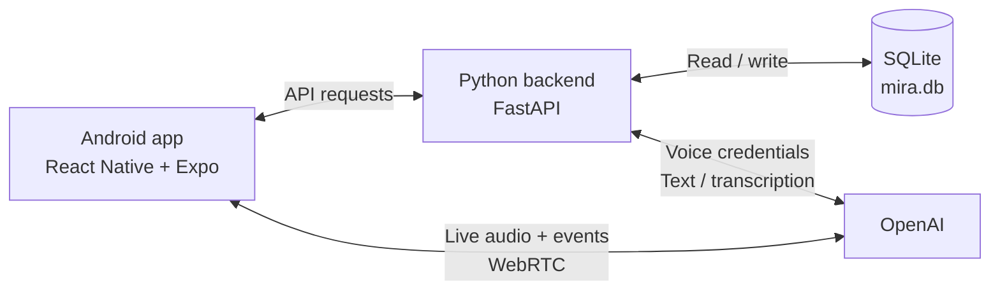
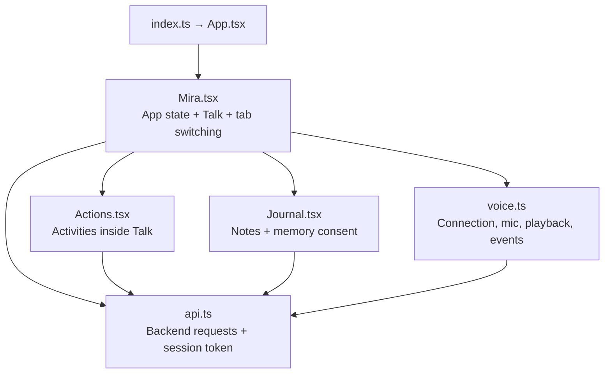
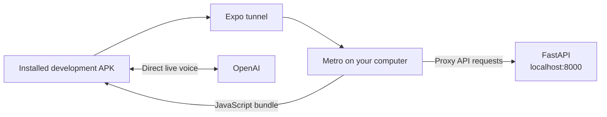
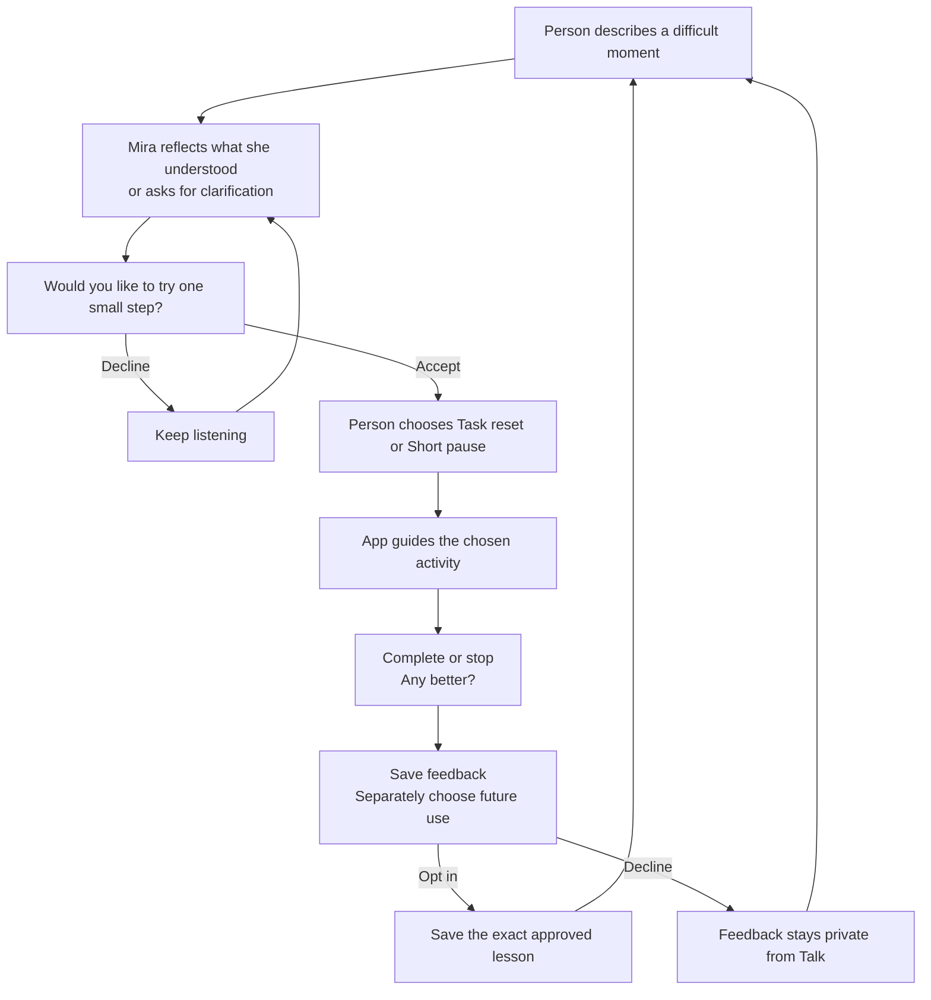
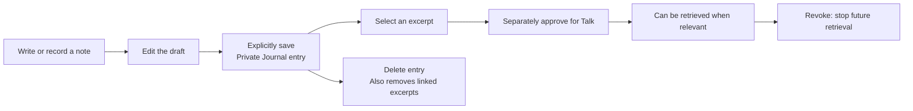

# Mira architecture

> Historical V0.02 description. Current navigation uses Expo Router and includes Talk, Actions, You, and a Do route. The catalog contains nine activities. See [the current code quality results](PRD/code_quality_results.md) for the reviewed backend changes and remaining architecture work. This file's older diagrams and tool descriptions must not be used as the current implementation map.

Based on the current repository, 14 October 2026. This describes the V0.02 demo; it does not verify the contents of a particular EAS build.

## 1. The big picture

**The phone owns the experience. FastAPI owns saved data and access to OpenAI. OpenAI generates replies.** Live voice travels directly between the phone and OpenAI.



## 2. Frontend: what runs on the phone

The app uses React 19, React Native 0.86, and Expo SDK 57. It currently switches between Talk and Journal using React state; there is no routing library in the implementation.



| File | Responsibility |
| --- | --- |
| `mobile/src/Mira.tsx` | Conversation, tentative moment state, voice/text switching, context notices, help, and overall UI coordination. |
| `mobile/src/voice.ts` | Native WebRTC via `react-native-webrtc`; push-to-talk, interruption, captions, reconnection, and tool relay. |
| `mobile/src/Actions.tsx` | Task reset, editable Now/Later/Ignore groups, optional timer, short pause, and feedback. No separate Actions tab. |
| `mobile/src/Journal.tsx` | Editable text/voice drafts, saved entries, approved excerpts, and consent revocation/deletion. Uses `expo-audio` for recorded Journal notes. |
| `mobile/src/api.ts` | Finds the backend address and attaches the demo session's bearer token. |
| `mobile/src/ui.tsx` | Shared colors, styles, and UI components. |

Conversation and activity UI state live in React memory. Journal drafts and explicitly saved private records are stored on-device through the local SQLite repository. Online worker requests receive only the bounded content needed for that request.

## 3. Backend: what runs on the computer

**`server/app.py`** is a FastAPI worker service. It creates short-lived demo sessions, configures voice sessions, validates tool calls, and calls OpenAI. Journal follow-up, sorting, transcription, and Talk are stateless workers; the private-data routes are retired and old clients receive an update-required response.

The app runtime does not instantiate `server/store.py` or open a private database. The legacy test database was deleted without import at the user's direction.

| API group | Purpose |
| --- | --- |
| `/health`, `/sessions` | Backend status and one active demo session. |
| `/sessions/{id}/voice` | Get a short-lived OpenAI credential for direct voice connection. |
| `…/tool-calls`, `…/tools` | Register and execute an allowed voice tool request. |
| `…/text`, `…/transcriptions` | Text replies and recorded Journal transcription. |
| `…/journal`, `…/memory` | Saved notes and separately approved excerpts. |
| `…/actions`, `…/action-runs`, `…/feedback`, `…/task-reset/organize` | Fixed activities, progress, feedback, and task sorting. |
| `…/reset` | Clear saved demo data. |

The long-lived OpenAI API key stays in `server/.env`. The phone receives an expiring demo token and a short-lived voice credential. This is a single synthetic demo user, with no account system.

## 4. One voice turn

```mermaid
sequenceDiagram
    participant P as Phone
    participant B as FastAPI
    participant O as OpenAI Realtime
    P->>B: Create demo session; request voice credential
    B->>O: Configure instructions, tools, and mic turn policy
    O-->>B: Short-lived credential
    B-->>P: Credential
    P->>O: Establish direct WebRTC connection
    Note over P,O: Mic off by default; automatic VAD disabled
    P->>O: Hold: stream audio; release: commit turn
    O-->>P: Reply audio and captions
    opt Model requests an allowed tool
        O-->>P: Tool call event
        P->>B: Register call, then request execution
        B-->>P: Context, fixed actions, or moment state
        P->>O: Tool result; continue reply
    end
```

The three allowed tools are `retrieve_shared_context`, `select_actions`, and `update_moment_state`. FastAPI checks arguments, voice generation, expiry, and duplicate execution. Provider events are relayed by the trusted demo phone; FastAPI does not independently observe them.

If voice drops, confirmed conversation text and moment state remain in app memory for **Retry voice** or **Continue with text**. Text takes the phone → FastAPI → OpenAI Responses route. Journal recording follows a separate upload → transcription → editable draft → explicit save flow.

## 5. What is remembered

| Location | Contents |
| --- | --- |
| Phone memory | Talk messages, moment state, drafts, task dump, grouping, timers, and loaded activities. Lost on app restart. |
| Backend memory | Expiring sessions and pending/completed tool-call bookkeeping. Lost on backend restart. |
| SQLite | Saved Journal entries, memory excerpts and consent flags, action runs, and feedback. |

Saved Journal notes are private from Talk until an excerpt is separately approved. Action activity can provide context; feedback requires a separate reuse opt-in, and helpful lessons require explicit consent. Journal supports revoking/deleting that context.

Mira does not persist Talk transcripts or task dumps in its database. Journal audio is temporary phone-cache data, sent to OpenAI for transcription and deleted after success or discard; failed transcription can be retried. OpenAI still receives the content needed to process each request.

## 6. How the development APK connects



EAS builds the installable native APK. During this development setup, **Metro, the Expo tunnel, and FastAPI must stay running**. With a LAN connection, API requests instead go directly to the computer's port 8000. This repository currently defines a development APK profile, not a standalone production deployment.

## 7. The user journey: one difficult moment

Mira's core loop is **listen → understand tentatively → ask → guide → check → optionally remember**. Journal is available separately throughout.



Example: someone says, “Too many things are on my mind.” Mira reflects that they may feel overwhelmed and asks before offering an activity. If they accept Task reset, they make a temporary list, adjust the suggested groups, and choose one small task. Afterwards, they can record whether it helped and decide whether Mira may use a specific lesson later.

## 8. Business logic: who decides what

| Decision | Owner and rule |
| --- | --- |
| What might the person need? | AI suggests a tentative understanding and support mode. This is conversational state, not a diagnosis. |
| Whether to try an activity | The person decides. Describing a problem does not count as permission. The voice prompt instructs Mira to ask first. |
| Which activities exist | The backend supplies two fixed choices. The model may offer those choices; it cannot add an activity to the catalog. |
| Which activity starts, stops, or completes | The person uses the app controls; the app manages progress and timers. A model statement alone does not start or complete a run. |
| How tasks are grouped | AI suggests Now/Later/Ignore; the person can move items and choose or edit the tiny task. |
| What may be remembered | The person approves a specific Journal excerpt or opts into future use of feedback and a lesson. The backend filters retrieval by those consent flags. |
| Whether feedback can be saved | The backend requires the activity to be completed, skipped, or stopped first. |
| Whether something was actually saved | A successful backend response confirms it. On failure, the app offers retry and keeps available local state. |

Some rules are **instructions to the AI**, such as asking permission and keeping replies non-clinical. Others are **enforced by code**, such as allowed action IDs, consent filtering, and valid action states. The prompt is not a guarantee of perfect model behavior.

## 9. The two activity workflows

| Activity | What happens |
| --- | --- |
| Task reset | Answer or skip “How stuck do you feel?” → enter a temporary list → get suggested groups → edit groups → choose one tiny task → optionally try it for five minutes → complete or stop → rate the outcome. |
| Short pause | Answer or skip the same opening question → follow the fixed pause steps for 60 seconds → complete or stop → rate the outcome. |

Timers can pause/resume and pause when the app enters the background. If task sorting fails, the original list remains available for manual grouping. These activities are neutral demo placeholders; Mpower clinicians have not yet approved their suitability or wording.

## 10. Journal and memory are separate choices



Saving a note does not automatically share it with Talk. Approval permits relevant retrieval; it does not mean Mira always uses the excerpt. When used, Mira is instructed to identify the source. Revocation prevents future retrieval; it cannot undo content already used in an earlier reply.

After an activity, the person can save a rating privately or opt into future use. In the current UI, opting in requires a short lesson, shown before saving. Journal provides controls to revoke future use or delete the saved feedback.

## 11. Recovery and human help

| Situation | User-facing behavior |
| --- | --- |
| Voice disconnects | Retry voice or continue with text, carrying confirmed conversation and moment state. |
| Backend or OpenAI unavailable | Show temporarily offline. Keep Journal and previously loaded activity content usable; local saves and lifecycle actions continue offline. |
| Journal transcription fails | Retry the recording or discard it. Text remains editable. |
| Activity runs offline | Continue locally; explicit activity preferences remain on-device. |
| Person asks for human help | Show the support placeholder and urgent-help card. No clinician is connected or monitoring the demo. |

The immediate-danger demo uses a scripted trigger to stop the normal flow and show the help card. It is not reliable crisis screening.

Scope reference: [approved PRD](PRD/mira_prd.md). Setup instructions: [README](README.md).
