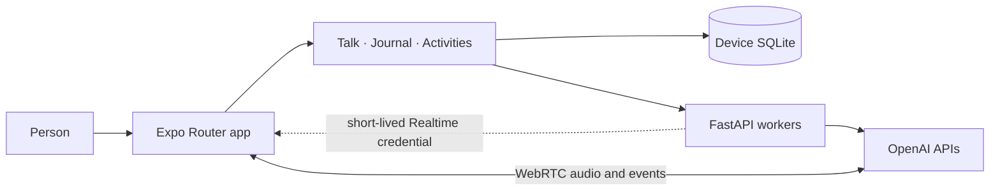

# Mira architecture

This describes the current implementation. The phone owns the app experience and private saved data. FastAPI provides short-lived worker requests to OpenAI; it is not the app's database.

## System view

The app entry is `expo-router/entry`. Routes and global providers are in `mobile/src/app`; feature screens, hooks, components, and repositories are grouped under `mobile/src/features`. `mobile/App.tsx` is not the active router entry.

## Mobile layers

| Area | Responsibility | Main files |
|---|---|---|
| Navigation | Root stack and Talk, Activities, and Journal tabs | `mobile/src/app/_layout.tsx`, `mobile/src/app/(tabs)/_layout.tsx` |
| Talk | Conversation UI, session state, local context selection, voice controls | `mobile/src/features/talk/TalkScreen.tsx`, `mobile/src/features/talk/hooks/useTalkSession.ts` |
| Activities | Bundled catalog, independent screens/controllers, local run lifecycle, compatibility-only legacy renderer | `mobile/assets/catalog/activities.json`, `mobile/src/features/activities/` |
| Journal | Home/editor screens, local drafts, and text entries | `mobile/src/features/journal/` |
| Shared infrastructure | Worker HTTP client, voice transport, SQLite connection and migrations | `mobile/src/shared/api.ts`, `mobile/src/shared/voice.ts`, `mobile/src/shared/storage/` |

Screens render the interface. Feature hooks coordinate screen behavior. Repositories perform local reads and writes. Shared modules provide capabilities used by multiple features.

## Data ownership

| Data | Location and lifetime |
|---|---|
| Activity definitions and assets | Bundled with the app; usable offline |
| Continue items and saved activity preferences | Device SQLite (`mira-private.db`) |
| Journal sessions, drafts, entries, excerpts, and legacy voice-note references | Device SQLite; any previously owned audio stays in app file storage |
| Current Talk messages and moment state | App memory; not persisted across restart |
| Firebase sign-in | Firebase Auth; persisted on-device with Expo SQLite key-value storage |
| Temporary voice relay bookkeeping | FastAPI process memory keyed by Firebase UID; expires or disappears on server restart |
| Content needed for an online operation | Sent in that request to FastAPI and OpenAI; not written as a Mira server record |

SQLite setup and ordered schema changes live in `mobile/src/shared/storage/database.ts` and its migration files. Repository calls run through one serialized transaction queue. Android backup and device-transfer exclusions are generated by `mobile/plugins/withDeviceOnlyData.js`; iOS backup exclusion behavior is not implemented or verified.

## Backend responsibilities

`server/app.py` provides:

- `/health` for diagnostics; `/workers/*` requires a verified Firebase ID token.
- `/workers/text` for an AI text reply and support decision.
- `/workers/voice` and `/workers/voice/transcription` for short-lived OpenAI Realtime credentials.
- `/workers/tool-calls` and `/workers/tools` for the bounded `choose_support` worker relay. Context retrieval and moment updates run on the phone.
- `/workers/task-reset/organize` for explicitly requested, stateless work. Journal has no backend route.

`server/interventions/decision.py` validates model support decisions against an eligible catalog. `catalog.py`, `eligibility.py`, and `client_registry.py` keep activity definitions and compatibility rules out of the UI. The app also bundles the activity content so browsing and running an activity do not need the server.

The Firebase web-app configuration lives in `mobile/src/shared/firebase.ts`; the server verifies ID tokens using the Firebase project ID and Google's published signing keys. The OpenAI API key stays in `server/.env`. The mobile app receives only a short-lived Realtime credential. Generous per-user/global rolling request caps and voice relay bookkeeping are process-local; deploy one server process/replica so both controls remain consistent. The standalone API origin is set in `mobile/app.json` at `expo.extra.apiUrl`; the `offline-gate` build requires HTTPS. Cleartext HTTP is included only in the EAS `development` profile.

Legacy private-data URLs are intercepted by `retire_private_data_api` and return HTTP 426 with an update message. Their old persistence handlers and `server/store.py` have been removed. The old test database was deleted without importing its test records.

## Request flows

### Text Talk

1. `useTalkSession` reads the user's local consent state and asks `contextRepository` to select at most one relevant approved excerpt and up to three relevant opted-in preferences.
2. `shared/api.ts` sends the recent conversation and bounded selected context to `/workers/text` with the signed-in user's Firebase ID token.
3. FastAPI validates the request, asks the decision adapter for a route, and calls OpenAI for the response.
4. The phone receives the reply, tentative moment state, and any activity offer. The user still chooses whether to open that activity.

### Voice Talk

1. The phone requests `/voice`; FastAPI configures a Realtime session and returns a short-lived credential.
2. The phone connects directly to OpenAI over WebRTC. Audio does not pass through FastAPI.
3. Local context retrieval and moment updates run on-device. When the model requests `choose_support`, the phone relays that one bounded request through `/tool-calls` and `/tools`.

### Journal and activities

Journal drafts and text entries stay on-device. The optional starter prompt is static content. A single Save action finalizes the entry and returns. Activities load from the bundled catalog and their run/Continue state is local. Optional task sorting and Brain Dump transcription are online workers; failure leaves the original local content available.

The `/do` route is `mobile/src/features/activities/ActivityRouteScreen.tsx`. `ActivityHost` resolves one canonical ID through `runtime/experienceRegistry.ts` and mounts that activity's independent screen. The nine primary Activities entries do not use the old shared runner. `legacy/LegacyActivityAdapter.tsx` retains the historical `task_reset_60s` renderer for compatibility; its screen mounts only the task-reset renderer pieces. Catalog, run lifecycle, art, assistance, local collections, and preference controls live under `features/activities/`.

## Network and offline behavior

Local screens, Journal saves, and activity lifecycle do not need FastAPI. Text replies, voice connection, Brain Dump transcription, and AI task sorting do. During development, `mobile/metro.config.js` proxies Mira API paths through Metro to FastAPI on port 8000. A standalone build does not need Metro for its JavaScript bundle, but online workers still need a configured reachable API origin.

Provider-side processing and retention are separate from Mira's server-storage policy. The app does not claim that provider requests are zero-retention.

## Code map

- Mobile routes: `mobile/src/app/`
- Feature implementations: `mobile/src/features/`
- Device persistence: `mobile/src/shared/storage/` and each feature's `data/` directory
- FastAPI worker routes and session lifetime: `server/app.py`
- Activity selection rules: `server/interventions/`
- Offline-first work and verification ledger: `PRD/mira_offline_first_plan.md`
