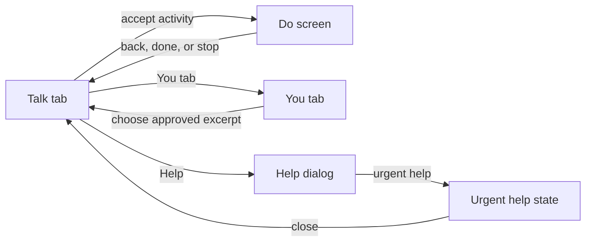
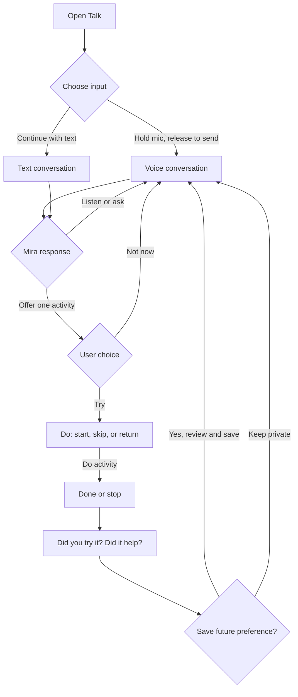
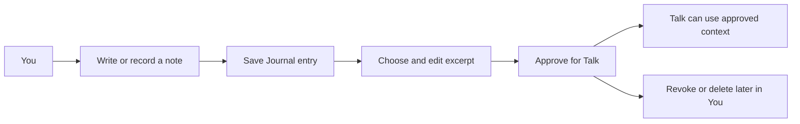

# Mira V0.03 — Current UX

This is a map of the UI that exists in the app today. It is an inventory, not a redesign proposal. Product limits come from [the PRD](PRD/mira_prd.md).

## At a glance

The app has **three main destinations**:

1. **Talk** — the home screen for voice or text conversation and optional activity offers.
2. **Do** — a full-screen activity route opened from Talk.
3. **You** — Journal, approved context, saved preferences, and demo reset.

Talk and You appear in the bottom tab bar. Do is a separate stack screen. Help and urgent help are states inside Talk, not separate routes. Journal is a section inside You, not a separate page.

## Routes and page contents

| Destination | Route / file | Main content and components |
|---|---|---|
| **Talk** | `/(tabs)` → `src/Mira.tsx` | Brand/header and Help button; “What’s going on?” heading; connection/status pill; current-moment card; approved-context notice and excerpts; voice retry and text fallback; optional conversation captions; one optional activity offer with Try / Not now; text composer when text mode is selected; hold-to-talk button; development diagnostics. |
| **Do** | `/do?id=…` → `src/DoScreen.tsx`, `src/InterventionRunner.tsx` | Back to Talk; activity category, title, summary, status; start/skip/return controls; an activity-specific experience; stop/done controls; tried/helpfulness questions; consent step for saving a future preference. |
| **You** | `/(tabs)/you` → `src/YouScreen.tsx`, `src/Journal.tsx` | Journal draft editor; save text or record/transcribe a short note; saved entries with delete and “Choose excerpt for Talk”; review/approve/revoke/delete context; saved outcome preferences with allow/stop/delete controls; reset demo data; privacy explanation. |
| **Help state** | Inside Talk (`src/Mira.tsx`) | Help dialog offers a support-route placeholder or urgent-help option. The urgent-help view explains the demo boundary and provides Close. |

Shared UI pieces in `src/ui.tsx`: `ActionButton`, `Surface`, `StatusPill`, `Eyebrow`, color tokens, and basic text/input styles. The tab shell is in `src/app/(tabs)/_layout.tsx`; the root stack is in `src/app/_layout.tsx`.

## Activity experiences

The Do screen reuses one runner but switches content by activity ID. Current special patterns include:

- **Task Reset:** temporary brain dump → optionally sort into now/later/ignore → choose a tiny next step.
- **Brain Dump:** temporary free-writing area.
- **Other activities:** step-by-step prompt; optional timer for Pause and Short Movement; a text field for Tiny Next Step.
- **All activities:** start or skip, finish or stop, answer whether it was tried and helpful, then choose whether Mira may suggest it again.

## Main journeys

### Talk and activity

### Journal and context

## Important states already represented

- Voice ready, connecting, listening, thinking, speaking, disconnected/offline, and retry.
- Text mode, sending, and request error.
- No matching context, matched approved context, and context revoked.
- Activity offered, declined, loaded, started, skipped, stopped, or completed.
- Journal draft, recording, transcription, retry/discard, saved entry, and empty list.
- Context pending approval, approved, revoked, or deleted.
- Feedback private, allowed for future use, changed, or deleted.
- Help dialog and urgent-help state.

## Visual direction recommendation

**Quiet editorial minimalism:** use the UI/UX Pro Max “Minimalism & Swiss Style” as a base, softened with Mira’s existing warm neutrals and forest green. Keep screens spacious, clear, and calm, with simple surfaces and light borders. Avoid heavy shadows, decorative gradients, and clinical-looking layouts. This is a design recommendation to test, not a final brand decision.

The style database’s wellness palette and Lora/Raleway pairing informed this choice. The database also returned a web landing-page pattern, which does not fit Mira’s native Android app and was not used. This visual direction does not select a central presence; keep no/minimal, abstract, and restrained character concepts open for research.

### Proposed light palette

| Role | Color | Use |
|---|---|---|
| Canvas | `#F6F3EC` | Warm page background |
| Surface | `#FFFEFB` | Cards and input surfaces |
| Main text | `#242B25` | Headings and body copy |
| Supporting text | `#536257` | Secondary labels and explanations |
| Primary action | `#3F6852` | Main buttons and selected states |
| Soft green | `#E8EFE8` | Quiet supporting highlights |
| Border | `#D6D8CF` | Surface and input outlines |
| Destructive | `#9A3D35` | Delete and urgent actions, with clear labels |

These colors already exist in `mobile/src/ui.tsx`. Sampled text pairs meet the chosen WCAG AA contrast baseline: primary action on surface is **6.28:1**, main text on canvas **13.09:1**, and supporting text on canvas **5.83:1**. Verify all actual component states before implementation sign-off.

### Proposed type pairing

- **Headings:** Lora, used selectively for large, human-feeling titles.
- **Body and controls:** Raleway, regular/medium weights; keep body text at 16sp or larger.
- Bundle fonts locally if adopted; retain Android/system fallback for unsupported glyphs and text scaling. Do not load fonts from a network at runtime.

This Lora/Raleway combination is the database’s “Wellness Calm” pairing. It is a proposal: check Hinglish readability, TalkBack/text scaling, and font availability before adding font assets or changing the app.

### Current design limits

Mira’s routes and components are mapped above, but personas and emotional needs remain unvalidated. The new visual direction and font pairing still need user testing. High-fidelity mockups and on-device contrast, TalkBack, and text-scaling checks remain future work. Keep the approved product flow and intervention rules unchanged.

## DRD snapshot

### Product and design goal

Mira V0.03 is a private, synthetic-data wellbeing companion demo. A person starts in Talk, may choose a suggested activity in Do, and can manage Journal/context/preferences in You. The PRD frames the product test as helping someone move from an ambiguous moment into one useful, optional activity.

**Proposed design-research goal:** test whether people understand the Talk → Do interaction before selecting visual styling, then compare visual directions on the same tested interaction. This comes from the attached research plan; no study results or approved numeric UI target are supplied.

### Users

No validated persona is available yet. The attached study plan proposes recruiting adults 18–30 in urban Tier-1/Tier-2 India, using mid-range Android phones, familiar with WhatsApp voice and UPI, and including people who share living spaces. That is a screener proposal, not evidence about participant behavior. Per the user's direction, do not turn it into a persona until findings are available. Clinicians are not users of this V0.03 app; content review by Mpower is a separate gate before wider use.

### Current style and platform

- Platform in scope: Android phone, with OnePlus as the primary demo/QA device.
- Existing palette: warm light background, white surfaces, dark green accent, muted text, restrained status colors (`src/ui.tsx`); the recommended mapping is listed above.
- Existing type sizes: title 30, heading 21, body 16, supporting text 14. Existing shared controls are `ActionButton`, `Surface`, `StatusPill`, and `Eyebrow`.
- Recommended visual direction: quiet editorial minimalism, using the existing warm/sage palette; still to be tested. Mpower brand assets are not approved in the current scope.
- Accessibility baseline for the UI brief: [WCAG 2.2 AA](https://www.w3.org/TR/WCAG22/) contrast (4.5:1 normal text, 3:1 large text and meaningful non-text controls), Android's [recommended 48 dp minimum touch targets](https://developer.android.com/guide/topics/ui/accessibility/apps), accessible TalkBack labels/order, and support for Android text scaling. Test sunlight readability separately; do not require AAA contrast everywhere by default. The study plan's 7:1 proposal for primary controls remains a test hypothesis.

### State coverage visible in the current UI

| Area | Loading / in progress | Empty / first use | Error / offline | Success / partial |
|---|---|---|---|---|
| Talk / voice | Show a concise connecting/listening/thinking status; keep the mic state visible. | “What’s going on?” with the hold-to-talk hint and text option. | “Voice is offline.” Keep Retry voice and Continue with text available. | Show connected status and the current moment; captions remain optional. |
| Talk / context | Do not block conversation while context is checked. | “No saved context matched. Mira can continue without it.” No action required. | Keep the same non-blocking message; do not imply context was used. | Label each excerpt’s source and say the person can ignore it. |
| Talk / activity offer | Do not show an activity card until a valid offer exists. | No card; keep the conversation usable. | Do not show an invalid offer; keep listening/text available. | Show one optional activity, a short reason, Try, and Not now. |
| Do / activity | Show the activity-specific progress/status while it starts or saves. | Before starting, explain the choice; offer Start, Skip, and Return to Talk. | If offline, say the loaded activity can continue and its outcome may stay on device. | Confirm the activity ended, then ask whether it was tried and helpful. |
| You / Journal | Label saving or transcription in progress and prevent duplicate submission. | “No notes yet. Write or record a private note.” Keep the text editor and Record action available. | State what failed; preserve editable text. For a retained recording, offer Retry transcription and Discard. | Confirm save/transcript; allow the person to edit a transcript before saving. |
| You / saved context and preferences | Show a short loading label without blocking other You content. | “Nothing saved for Mira to use yet.” Explain that context/preferences appear only after the person chooses to save them. | “This change wasn’t saved. Try again when Mira is online.” Keep the item visible and its prior state clear. | Label pending/approved/revoked states and keep the matching Approve, Revoke, or Delete action visible. |
| Help | Not applicable. | Help dialog offers support route or urgent help. | Clearly say the support route is not connected; never imply someone was contacted. | Urgent-help view explains the demo boundary and offers Close. |

These are text-level design requirements for the existing surfaces. They do not add routes or change product behavior. The accessibility baseline is selected; color pairs, final visual treatment, and usability remain to be verified.

### Journey and emotional evidence

| Step | User does | Feeling to observe (not assume) | Current support |
|---|---|---|---|
| Open Talk | Decides whether to speak or type | Privacy, uncertainty, or readiness | Mic-off-by-default hint, hold-to-talk, text fallback, Help |
| Explain the moment | Shares what is happening | Whether Mira feels attentive or rushed | Conversation and current-moment summary |
| Receive support | Accepts, declines, or keeps talking | Whether the offer feels optional | One activity offer with Try and Not now |
| Do the activity | Starts, skips, stops, or completes | Whether instructions feel clear and manageable | Activity-specific runner and exit controls |
| Check outcome | Rates whether it helped and whether to save preference | Whether the follow-up feels respectful | Explicit choice before saving preference |
| Return later | Opens You to write or review context | Whether privacy and control remain clear | Journal, approved context controls, preferences, delete/reset |

The study plan provides a scenario, not observed emotional results. Treat the 5-second first impression and immediate journey as testable; long-term emotional or wellbeing outcomes are outside this demo's evidence.

### Existing success checks

The PRD's V0.03 checks are the current product acceptance criteria: start Talk by voice/text, reach an appropriate route, consent before Do, finish or stop an activity, collect outcome feedback, manage consented context in You, and complete a synthetic Android walkthrough. The study plan proposes unprompted comprehension thresholds for its own test, but those are not results or product acceptance criteria yet. No separate UI baseline exists.

## Research input: proposed study, not findings

`PRD/mira_design_research_steps_6_7_8.md` is a study plan. It proposes a participant cohort and tests, but contains no completed participant observations or results. Per the user's direction, do not turn its proposed cohort into a validated persona yet.

### Proposed cohort and test topics

- Provisional cohort hypotheses: adults 18–30 in urban Tier-1/Tier-2 India; mid-range Android users; familiar with WhatsApp voice notes/calls and UPI; include people who share living spaces to examine privacy. Age, location, device-price band, app habits, and sample-size values are recruiting hypotheses, not validated facts about the audience.
- Proposed method: observe what participants do naturally before prompting. Use a scripted scenario only when a behavior does not happen on its own. Test Talk, responding to an offer, pausing or stopping, switching to text, completing representative activities, and returning to Talk.
- Proposed real-world contexts: shared-room privacy, one-handed use, low light, sunlight, background noise, weak network, and mid-range Android performance.
- Presence directions to compare on the same interaction layout: no central presence/minimal; subtle abstract presence; restrained 3D/character presence. Keep the central presence open; an orb is not the assumed winner. The attachment's warm/tactile system can be tested as a visual treatment, not treated as selected.
- Proposed pass gate: revise interaction comprehension issues before choosing a visual direction. The document gives inconsistent sample ranges (5–8 in its title; 6–8 in recruitment) and should settle that before recruitment.

### Keep research proposals separate from current V0.03 behavior

The study may compare UI concepts such as a temporary choice surface, additional call controls, a mic-locked brain-dump presentation, background timer presentation, and animated presence. These are hypotheses for research prototypes, not current app behavior or production requirements. Preserve the approved V0.03 product logic and intervention rules during this study; do not change the PRD or production flow based on a prototype alone. Any product-scope change requires evidence and a separate decision. In particular, do not ship hands-free voice behavior or replace explicit push-to-talk through this design study.

The proposed audience is a starting recruitment hypothesis, not a persona. Per the user's direction, define a persona only after actual research findings. Observed behavior, emotional needs, ideal device/timing values, and concept preference remain open until the study is run and reviewed.

### Decisions for the study

- Expand the study to compare new UI concepts as hypotheses while preserving V0.03 product logic and intervention rules.
- Do not assume an orb or other central presence is preferred; compare no/minimal presence, subtle abstract presence, and restrained 3D/character presence.
- Treat precise persona, device, price, app-habit, and timing thresholds as provisional until tested.
- Observe natural behavior before prompting; use scripted scenarios only when the behavior does not occur naturally.
- Keep the current PRD authoritative. Research findings may support a later scope proposal, but do not change product scope automatically.

### User decisions recorded

- Specify key loading, empty, error, and success states in this brief.
- Wait for actual research results before defining a persona; the proposed participant screener is not a validated persona.
- Expand research to compare new UI concepts as hypotheses, while preserving V0.03 product logic and intervention rules. Do not change the PRD automatically.
- Keep the central presence open; compare minimal/no presence, subtle abstract presence, and restrained 3D/character directions.
- Treat exact persona, device, price, app-habit, and timing values as hypotheses; observe naturally before prompting.
- Use WCAG 2.2 AA contrast, Android's recommended 48 dp targets, TalkBack support, and text scaling as the UI accessibility baseline.

### What already exists

- Three destinations: Talk, Do, You; Help and urgent-help are states inside Talk.
- Expo Router tab/stack navigation, shared safe-area layout, reusable buttons/surfaces/status elements, and a small color/type token set.
- Voice/text recovery, one optional activity offer, consented outcomes/preferences, Journal draft and excerpt controls, and synthetic-data/demo reset.

### Not in scope for the V0.03 UI study

- Changing intervention eligibility, selection, consent, or safety rules; adding clinical content or a connected human-support route.
- Shipping an open-ended activity catalog, multi-activity chooser, hands-free/automatic VAD voice, lock-screen/live-update timer, background recording, or 3D presence implementation.
- Changing the current PRD or product behavior solely because a prototype tests better; evidence can inform a separate scope decision.
- Mpower branding, public launch/pilot flows, user accounts, or persistent conversation history.

## Source files

- Routes: `mobile/src/app/_layout.tsx`, `mobile/src/app/(tabs)/_layout.tsx`, `mobile/src/app/(tabs)/index.tsx`, `mobile/src/app/(tabs)/you.tsx`, `mobile/src/app/do.tsx`
- Screens: `mobile/src/Mira.tsx`, `mobile/src/DoScreen.tsx`, `mobile/src/InterventionRunner.tsx`, `mobile/src/YouScreen.tsx`, `mobile/src/Journal.tsx`
- Shared UI: `mobile/src/ui.tsx`

## Implementation Tasks

These are research and design tasks only; they do not authorize V0.03 product-scope changes.

- [ ] **T1 (P1, human: ~30 min / Codex: ~10 min)** — Study protocol — reconcile the participant range and define one observation log before recruitment.
  - Surfaced by: Pass 3 — the source document says 5–8 in one place and 6–8 in another.
  - Files: `PRD/mira_design_research_steps_6_7_8.md`, `CURRENT_UX.md`
  - Verify: one sample range; natural behavior is observed before any scripted prompt; exact timing thresholds remain hypotheses.
- [ ] **T2 (P1, human: ~1–2 days / Codex: ~30 min)** — Run the interaction study — test current V0.03 behavior and approved UI hypotheses without changing intervention or voice rules.
  - Surfaced by: Pass 3 — persona and emotional needs lack observed evidence.
  - Files: research notes, `CURRENT_UX.md`
  - Verify: record what each participant does before prompting and which UI concepts caused confusion; do not infer a product-scope change from prototype preference alone.
- [ ] **T3 (P2, human: ~half day / Codex: ~30 min)** — Compare presence directions — test minimal/no presence, subtle abstract presence, and restrained 3D/character on the same interaction layout after the flow is tested.
  - Surfaced by: Pass 5 — visual direction is intentionally unselected.
  - Files: design comparison artifacts, `CURRENT_UX.md`
  - Verify: user feedback selects or rejects directions; an orb is not assumed.
- [ ] **T4 (P2, human: ~2 hours / Codex: ~30 min)** — Verify accessibility baseline — check text contrast, touch targets, TalkBack order/labels, and text scaling on the Android build.
  - Surfaced by: Pass 6 — the baseline is defined, but not yet checked on-device.
  - Files: `mobile/src/ui.tsx`, affected screen components
  - Verify: WCAG AA contrast targets and 48 dp touch targets are met; TalkBack and larger text remain usable.

## Design Review Scorecard

| Pass | Before → after | Result |
|---|---:|---|
| 1. Information architecture | 8 → 9 | Three destinations, routes, page contents, and navigation are clear. |
| 2. Interaction states | 6 → 9 | Added user-visible state guidance for Talk, Do, You, and Help. |
| 3. Journey and emotional arc | 5 → 7 | Added a storyboard; feelings and persona remain unvalidated until research runs. |
| 4. AI-slop risk | 6 → 7 | No confirmed hard rejection from source review; the app has stacked surfaces, so visual quality still needs a rendered review. |
| 5. Design system | 5 → 8 | Added a database-informed style, palette, and font recommendation; central-presence choice remains open for research. |
| 6. Responsive and accessibility | 4 → 8 | Added WCAG AA/Android baseline; on-device TalkBack, text scaling, and contrast checks remain. |

**Overall design score:** 4/10 → 7/10 (lowest of the six passes). Step 0 initial impression: 6/10. This is a useful current-state map and research brief, but not a final visual design.

The skill's startup script could not emit its status because Bash is unavailable in this environment. The gstack visual designer is not installed, so no mockups or comparison board were produced. This review is text-only; it does not claim a pixel-level visual pass.

The project `TODOS.md` was not changed. The research tasks above are recorded here; production changes still need a separate scope decision if research suggests changing V0.03 behavior.

## GSTACK REVIEW REPORT

| Review | Trigger | Why | Runs | Status | Findings |
|---|---|---|---:|---|---|
| CEO Review | `/plan-ceo-review` | Scope and strategy | 1 | issues_open | Prior review: 5 proposals, 4 accepted, 1 deferred. |
| Outside Review | design outside voices | Independent second opinion | 0 | skipped | No external review run in this pass. |
| Eng Review | `/plan-eng-review` | Architecture and tests | 1 | clean | Prior review: 5 issues, 0 critical gaps. |
| Design Review | `/plan-design-review` | UI/UX gaps | 2 | issues_open | Prior review was clean; current review: 6/10 → 7/10, 4 user decisions recorded. |
| DX Review | `/plan-devex-review` | Developer experience | 0 | not run | Not in this review's scope. |

**OUTSIDE COVERAGE:** skipped; no outside provider was run for this design phase.

**VERDICT:** Current UI map and study direction are ready for review. Visual design is not ready to implement as a selected direction; research findings and a visual comparison are still needed. The earlier engineering review was clear for its scope.

**UNRESOLVED DECISIONS:**
- Persona and emotional needs await actual participant findings.
- Choose the central-presence direction after the interaction and visual studies.
- Reconcile the study's participant range and finalize success thresholds before recruitment.
- A rendered visual review remains pending because the design tool is unavailable.
- + 4 unresolved from prior reviews.
