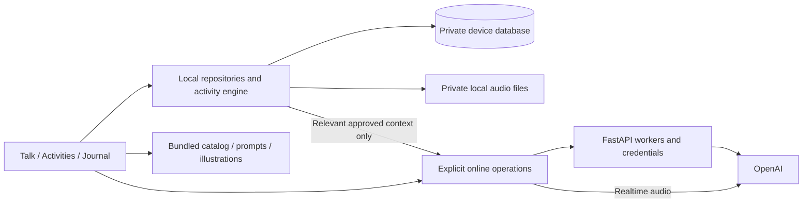

# Mira: offline first implementation plan

Date: 19 October 2026
Status: OF-01 through OF-06 code implemented and checked. Native builds and installation/device verification remain deferred until implementation is finished, per the user's instruction. Next batch: OF-07.

## 1. Approved direction

The phone owns the experience and all saved private data. The server performs requested computation and calls external APIs. Private request content may pass through the server or directly to OpenAI when a feature needs it, but our server does not retain it as application data.

This supersedes the earlier proposal to synchronize Journal, memory, preferences, and activity runs to the backend. There is no private-data synchronization service, upload outbox, cloud Journal, or automatic activity tracking in this plan.

Preserve existing navigation, activity flows, explicit hold-to-talk, consent choices, and temporary-writing rules. This work changes data ownership and removes network gates; it does not authorize new product flows. PII filtering and additional integrations remain future scope.

## 2. Baseline implementation and gaps (before OF-01)

| Area | Current code / behavior | Required change |
|---|---|---|
| Activities library | `mobile/src/features/actions/ActionsScreen.tsx` has local fallback card text but still fetches `/actions` on focus. | Read the complete bundled catalog; remove the remote dependency and duplicate fallback copy. |
| Activity definitions | `server/interventions/catalog.py` owns full definitions; `shared/interventions.ts` remembers fetched definitions in a process-only map. | Bundle full compatible definitions and use them directly. |
| Activity lifecycle | `features/do/hooks/useInterventionRun.ts` fetches content, waits for a server-confirmed start, and PATCHes completion/stop. | Local run IDs and local state transitions; no server confirmation. |
| Continue | `shared/interventions.ts` stores explicitly kept items in a device JSON file. | Preserve existing data and resume semantics through a local repository. |
| Journal | `features/journal/hooks/useJournalController.ts` reads/writes sessions, entries, excerpts, and preferences through FastAPI. Submitting writing depends on generating a follow-up. | Store locally; saving writing must succeed independently of AI. |
| Journal audio | `useJournalRecording.ts` records local files; `saveVoiceNote()` keeps file references only in React state. | Persist references for explicitly saved notes; manage attachment ownership and cleanup. |
| Journal transcription | FastAPI exposes `/transcriptions`, but the current Journal recording UI does not call it. | Do not introduce a new transcription flow as part of this migration. Keep the worker only if still needed. |
| Saved letters | `shared/letters.ts` stores a local archive; legacy letter flows expose explicit saving. Canonical Unsent Letter does not expose that save action. | Preserve existing saved archives and supported legacy behavior; do not auto-save canonical Unsent Letter drafts. |
| Talk | `features/talk/hooks/useTalkSession.ts` holds conversation, moment state, and unsent text in memory. Responses use FastAPI/OpenAI. | Keep live continuity; obtain approved context from device repositories. |
| Realtime voice | `shared/voice.ts` gets credentials from FastAPI and streams directly to OpenAI. Tools are relayed to FastAPI. | Keep media path and mic contract; move local-data tools to the device boundary. |
| Brain Dump speech | `shared/transcriptCapture.ts` uses server-issued OpenAI credentials for transcription. | Keep optional online transcription; typed activity remains fully offline. |
| Activity preferences | Server SQLite stores explicitly opted-in feedback and associated run metadata. | Save exact approved preferences on the device. Non-consented feedback remains temporary. |
| Context retrieval | `server/store.py` retrieves approved excerpts/preferences from server SQLite. | Retrieve locally; send only relevant approved context for a requested AI operation. |
| Session access | `shared/api.ts` calls `/health` inside `getDemoSession()`, including for local screens. Requests have a shared 50-second timeout. | Acquire online capabilities lazily and use operation-specific failure handling. |
| Installed app | `mobile/eas.json` defines a development build; testing currently relies on Metro/tunnel. | Add an installable preview build with a bundled JS/assets payload for real offline launch checks. |

## 3. Ownership and retention

| Data | Device lifetime | Network use | Our server storage |
|---|---|---|---|
| Activity definitions, illustrations, examples, prompts, Help copy | Bundled public content | Server uses the same public definitions for AI eligibility/ranking. | Public content only. |
| Saved Journal entries, sessions, associated AI follow-ups | Durable until explicitly deleted | Only the bounded writing/history needed when requesting an AI follow-up. Never bulk upload the Journal. | None. |
| Journal editor recovery draft | Durable local recovery until saved or discarded | Only when the user invokes the existing AI operation. | None. |
| Explicitly saved voice notes | Durable local file plus local metadata until deleted | None for playback; transcription only if an existing supported action requests it. | None. |
| Pending recordings | Local files while the existing keep/discard interaction is active | Only for an explicitly requested transcription. | No retained audio. |
| Continue action/message | Durable after explicit Keep; versioned and resumable | No automatic transmission. An approved action handoff into Talk remains explicit. | None. |
| Pending/approved Journal excerpts | Durable locally; approval and revocation are local state | Only approved, relevant excerpts may be sent for Talk. Pending/revoked items never qualify. | None. |
| Opted-in activity preference | Durable exact approved text plus minimum provenance | Relevant preferences may accompany an AI request. | None. |
| Activity progress, participation, unapproved feedback | Live activity/session only | No run or feedback upload. | None. |
| Brain Dump, canonical Unsent Letter, perspective/feeling/thought inputs | Live activity only; clear on final exit/discard according to existing flow | Optional transcription or exact user-selected handoff only. | None. |
| Existing explicitly saved legacy letters | Durable archive on device | Only a deliberate selected-text handoff. | None. |
| Talk messages, moment state, unsent composer text | Live app session; preserve across mode changes and temporary disconnect | Needed conversation context goes to OpenAI through the appropriate path. | No durable transcript. |
| Excerpt transfer token and payload | In-process, one-time, acknowledged | No upload until the person presses Send in Talk. | None. |
| Capabilities, tool deduplication, worker status | Short-lived operational state | Used to authorize and correlate online work. | Bounded RAM metadata; private payloads only while needed for processing. |

Offline support does not add transcript history, automatic activity history, hidden draft retention for expressive activities, or a new saved-letter feature.

## 4. Target structure



### Bundled catalog

- Keep approved public activity data in one versioned, platform-neutral source: `mobile/assets/catalog/activities.json`. This location includes it in the mobile bundle without requiring Metro to resolve files outside the mobile project; the Python adapter reads the same file.
- Have Python and TypeScript adapters consume that source; use generated bundled artifacts only if packaging requires them. Never maintain two handwritten canonical catalogs.
- Include IDs, aliases, content version, review status, titles, descriptions, presentation pattern, steps, and eligibility metadata.
- Keep native illustrations and local image/font assets bundled with the app. New artwork design remains separate work; this migration ensures existing assets work offline.
- Validate primary IDs and supported patterns against the installed client. Server ranking returns compatible IDs; the phone resolves approved display content locally.
- A mismatched server cannot replace app steps or offer an unsupported activity. Continue without that suggestion; do not block the local library.

### Local repositories

Use a small repository layer backed by app-private transactional SQLite. This supports atomic Journal deletion with linked excerpts and keeps persistence out of screens/hooks. Keep audio as local files, with attachment rows linking them to their owning Journal session.

Proposed modules:

```text
mobile/src/shared/storage/
  database.ts                    initialization and schema migrations
  migrations/                    ordered, idempotent migrations
mobile/src/features/journal/data/
  journalRepository.ts           sessions, entries, messages, recovery drafts
  attachmentRepository.ts        kept audio references and deletion cleanup
  memoryRepository.ts            excerpt approval, revocation, source linkage
mobile/src/features/actions/data/
  continueRepository.ts          existing explicit Continue items
  preferenceRepository.ts        exact opted-in preferences
mobile/src/features/do/
  catalog.ts                     bundled catalog adapter
  activityEngine.ts              local run lifecycle and IDs
mobile/src/shared/context/
  contextRepository.ts           approved local retrieval and source labels
mobile/src/shared/online/
  workerClient.ts                explicit model/transcription operations
```

These are responsibility boundaries, not a requirement to create every file immediately. Reuse existing modules where they already provide the boundary; avoid introducing a second state-management framework or generic sync engine.

Suggested tables: `journal_sessions`, `journal_entries`, `journal_messages`, `journal_drafts`, `journal_attachments`, `memory_items`, `activity_preferences`, `continue_items`, and migration metadata. Preserve existing record IDs where possible. Do not add a durable table of every activity run or Talk turn. A saved preference can contain its minimum activity provenance without retaining the raw run inputs.

Dependency decision: OF-03 installed `expo-sqlite` 57.0.4 using Expo's SDK 57 installer and verified the matching documentation and installed APIs. A fresh native build is required before using it on the phone; the user has deferred that build until implementation is finished. Continue the remaining code work without launching intermediate builds. Native loading is lazy and guarded, so older APKs get a build-update message instead of crashing on import. No Expo/RN upgrade was made. Plain SQLite is not application-level encryption; custom encryption/key management is separate hardening, not a claim made by this plan.

Exclude private databases and audio files from automatic cloud backup/device-transfer mechanisms where supported, including Android extraction rules. Configure this through Expo config/plugins. App-private paths alone do not establish device-only retention. Record any platform limitation rather than claiming a guarantee.

### Local activity engine

- Resolve content synchronously from the bundle. Local initialization must not wait for a capability, health request, or server.
- Generate one local run ID and use it for Continue and transfer deduplication. Opening/start/skip/pause/stop/complete are local state transitions.
- Keep live progress in activity-owned state. Preserve temporary background/read-mode behavior; keep existing timer pause behavior.
- Continue resume restores the compatible saved action/draft rather than restarting an empty exercise.
- Keep outcome participation and feedback optional. Save a future preference only after the existing exact-text consent; all other feedback disappears with the session.
- A server outage cannot prevent finishing or returning. There is no later upload of run events.

### Local Journal

- Home reads recent sessions from the device. Tab button continues to open a new editor; Activities opens Journal home; New entry opens the editor. Preserve the existing route contract.
- Creating, choosing a static prompt, writing, appending an entry, saving a session, opening saved writing, and deleting are local operations.
- Commit the user's submitted writing before beginning the optional AI follow-up. A failed AI request cannot undo or prevent a local save.
- Keep the existing submit interaction as the trigger for a follow-up when available; avoid adding a new AI screen. Offline, commit the writing and allow the person to continue or save with no generated reply.
- Persist an editor recovery draft locally with bounded/debounced writes and flush on existing lifecycle boundaries. Explicit discard removes it; submitting/saving clears or advances it atomically. A late autosave must not recreate discarded content.
- Preserve the tab's New Entry behavior without silently overwriting an earlier recovery draft. Existing Journal home can list unfinished sessions with a simple state label; no new recovery navigator.
- AI follow-ups use a stateless worker accepting bounded recent Journal messages and returning text only. Associate results with a local request/entry revision so stale replies cannot enter a different or deleted session.
- Persist explicitly kept voice-note metadata and file ownership. Deleting a note/session removes its references and files; failed file deletions use local cleanup metadata and retry safely. Do not delete unrelated files.
- Local save success means a successful local commit. Disk-full/corrupt-storage failures retain the editor and show an honest retry state.

### Local context and consent

- Port the existing deterministic relevance rules to the phone initially. Retain source labels and a small result limit; no embedding service or whole-library model upload.
- Build context from approved, non-revoked excerpts and explicitly opted-in preferences. Do not infer persistent traits or approve model-supplied IDs.
- Check consent immediately before transmission, including retry. Bind prepared requests to a local consent revision; discard stale payloads.
- Deleting a Journal entry removes linked excerpts in the same database transaction. Revocation changes local eligibility immediately, even offline.
- On revocation/deletion, clear pending matching context and invalidate ongoing Talk context. Cancel/rebuild or reconnect the live voice conversation without revoked context, preserving the existing conversation where compatible. Do not reintroduce removed excerpts from stale moment/context state.
- Content already sent to a provider cannot be retracted. Future requests must exclude revoked context; automatic replay of a revoked payload is forbidden.

### Online boundary

- Keep short-lived server capabilities for online features; they are not identities for local records.
- Acquire/refresh capabilities when an online operation needs one. Local navigation, local storage, and tab focus do not create sessions or ping health.
- Replace unconditional per-call health checks with bounded renewal after expiry or a confirmed invalid capability. Cancel superseded operations and avoid stale response updates.
- Treat network availability as a hint. Handle provider errors separately from device connectivity; a connected phone can still have an unavailable provider.
- Online retries must be deliberate and bounded. Never automatically send an old private draft after reconnect or process restart. Rebuild approved context on retry.
- No private job queue on disk. Current workers run inline or in bounded volatile jobs; clear payload references after completion/expiry. Restarting the server may lose in-flight work; the device retains its writing.
- Logs contain operation/status/timing identifiers only. Do not log request bodies, excerpts, audio, model responses, capabilities, or raw provider error bodies. Disable/private-redact request capture and tracing for these routes.

### Realtime voice and tools

- Preserve direct phone-to-OpenAI WebRTC, server-issued short-lived credentials, mic-off default, hold-to-speak, release-to-end, interruption, and audio ownership.
- Dispatch `retrieve_shared_context` on the phone through the consent-aware repository. Send only its permitted result to the active provider conversation.
- Validate `update_moment_state` locally and keep it volatile.
- Keep `choose_support` as an online worker using public catalog data, compatible IDs, current constraints/declines, and only relevant opted-in preferences supplied for that operation.
- Preserve tool name/argument validation, generation/turn scoping, call deduplication, expiry, and authorization for server-executed tools. Moving retrieval local must not permit a model to read arbitrary files, approve memory, or execute a local write.
- Update tool registration/relay contracts and prompts together. The server must stop looking up private records by `feedback_id` or `source_entry_id`.

## 5. Per-activity offline behavior

| Activity | Fully local behavior | Connection needed only for |
|---|---|---|
| Grounding | Intro, sensory prompts, acknowledge/skip, outcome, exit | Nothing in the exercise. |
| Paced Breathing | Setup, pacing visual, rounds, stop, outcome | Nothing in the exercise. |
| Brain Dump | Prompts, typing, review/edit, selected-excerpt handoff, discard | Optional held-speech transcription; sending the selected draft in Talk. |
| One Small Step | Input, task slips, manual choices, examples, action card, Continue | Existing optional AI sorting only where already offered by a supported/legacy flow; no new AI dependency. |
| Notice & Name | Words, custom text, phrase editing, reflection, exit | Sending an explicit selected handoff if the existing flow supports it. |
| Unsent Letter | Prompts, editing, word count, read view, perspective, discard, selected handoff | Sending the selected draft in Talk. |
| Reach Out | Intent, local starter templates, edit/review, explicit Continue save | Nothing in preparation. Clipboard remains deferred as previously requested. |
| Move / Change Your Scene | Accessible choices, away screen, elapsed time, return, optional Continue | Nothing in the exercise. |
| One Song Break | Source choice, local link validation, OS app handoff, away/return, self-report | External music may need internet; Mira cannot promise playback or confirm listening. |

Legacy IDs and previously kept records remain compatible where they are supported today. This migration does not add them to the nine-card library.

## 6. API disposition

| Current route / responsibility | Target |
|---|---|
| `/health`, `/sessions` | Retain for diagnostics and online capabilities; no local-screen dependency. |
| `/voice`, `/voice/transcription` | Retain credential workers; request-scoped approved context/constraints only. |
| `/text` | Retain AI reply/decision worker; receive explicit bounded context, remove SQLite lookups. |
| `/tool-calls`, `/tools` | Retain only the required remote tool boundary; local retrieval and local moment state leave the persistence path. |
| `/task-reset/organize` | Retain only for existing optional AI sorting; manual sorting remains immediate. |
| `/transcriptions` | Retain only if there is a supported caller; no automatic audio upload or new Journal transcription action. |
| `/journal`, `/journal-sessions` CRUD/save/prompt | Replace with local repositories. Remove private server persistence. |
| `/journal-sessions/{id}/turn` | Replace with stateless Journal follow-up worker; no create/save operation on the server. |
| `/memory` create/list/approve/revoke/delete | Replace with local repository; no server memory library. |
| `/feedback` save/reuse/delete | Replace with local preference repository. |
| `/actions`, `/interventions` content reads | Remove mobile use. Public catalog may remain server-internal for selection; unnecessary public endpoints can be retired. |
| `/interventions/{id}/start`, `/action-runs/{id}` | Remove mobile use and private run storage. |
| `/interventions/{id}/decline` | Keep decline in live local conversation state and pass excluded IDs for the requested selection; no durable record. |
| `/reset` | Retire private-store reset after migration. Do not restore the removed reset button. |
| `server/store.py`, `server/mira.db` | No application runtime dependency after cutover. Remove the legacy database only after a deliberate preservation/cleanup decision. |

The long-lived OpenAI key stays on the server. Provider-side processing and retention are separate from our server-storage policy; no zero-retention provider claim is part of this plan.

## 7. Migration and compatibility

1. Preserve existing phone Continue items, saved-letter archives, and the transitional device preference file introduced in OF-02 (`mira.activity-preferences.v1.json`). Import with original IDs, timestamps, content versions, and explicit-save meaning; repeated imports must not duplicate records.
2. Verify the imported local data before retiring the old files. A migration failure leaves source data intact and does not replace it with an empty database.
3. Existing server Journal/preferences are a one-time migration problem, not a permanent sync feature. Use a developer-controlled import into the intended demo phone only if preserving those records is desired. Do not silently import the global synthetic demo store into every installed client.
4. Import saved Journal sessions and their linked approved/pending/revoked excerpts consistently. Do not label all server-created unfinished sessions as explicitly saved. Preserve their draft status where kept.
5. Existing unattached audio files cannot be safely identified from filenames alone. Reconcile known owned references; do not sweep-delete the documents directory. Do not claim lost in-memory references have been recovered.
6. Verify local counts, relationships, and a small synthetic readback without printing private payloads. Record migration version/completion locally.
7. Stop old server writes at cutover. Pair the new app and worker API contracts so an old client cannot keep saving private data to retired endpoints. Unsupported old clients receive a clear update error.
8. Remove legacy server records, SQLite sidecar files, temporary exports, and any known copies only after the local migration is verified and their removal is explicitly authorized. No destructive cleanup is authorized by this planning step.

## 8. Sequential work orders

Execute one work order at a time. Each order ends with its result, focused verification, known limitations, and an updated ledger below. Keep the existing activity-blueprint work-order numbering separate.

| Order | Deliverable | Dependencies | Acceptance |
|---|---|---|---|
| OF-01 | Shared public catalog and complete bundled activity content/assets | None | All nine definitions resolve locally; Python/client IDs, versions, aliases, and patterns agree. No duplicate card-copy catalog. |
| OF-02 | Local activity lifecycle and Continue integration | OF-01 | All nine open/start/finish/stop without backend; existing Continue resume works; no activity lifecycle requests. |
| OF-03 | Local database, repository foundation, and local-file import | OF-02 | Atomic writes/deletes and restart readback checks pass; old local data is preserved; backup exclusions configured. Native build/install verification deferred to the final build by user instruction. |
| OF-04 | Local Journal sessions, entries, recovery drafts, and voice-note references | OF-03 | Airplane-mode create/save/reopen/delete works, including audio; AI failure cannot block committing writing; route behavior stays correct. |
| OF-05 | Local memory approval/revocation, exact preferences, and relevant context selection | OF-03, OF-04 | Approval/revocation/deletion work offline; no non-consented persistent outcomes; linked deletion is atomic; no whole-library context upload. |
| OF-06 | Stateless AI workers, lazy capabilities, and local tool dispatch | OF-02, OF-04, OF-05 | Text/voice/follow-up/optional transcription work with explicit context; mic contract and generation guards hold; local actions do not ping server. |
| OF-07 | Verified existing-server-data import and worker-only server cutover | OF-03 through OF-06 | Preservation decision recorded; selected data verified on phone; server private writes/lookups disabled; stale clients cannot recreate private records. |
| OF-08 | Final native build, standalone offline launch, focused flow gate, and documentation alignment | OF-07 | Build after implementation is finished; verify new native modules, device import/readback, and bundled offline cold launch. Nine activities and Journal work; online recovery works; docs describe actual ownership and limitations. |

During OF-03/04, establish local storage APIs before replacing feature hooks. During OF-06, update the client and server request contracts together. Intermediate development states can retain the legacy backend for unmigrated features, but must be labeled incomplete until OF-07 removes runtime private storage. Do not claim the new architecture is finished halfway through.

## 9. Focused verification

Automate only behavior that risks privacy, data loss, or a broken boundary:

- Catalog parity/compatibility and unsupported AI IDs.
- Local repository transaction failure, idempotent import, linked deletion, and late draft-write cancellation.
- Activity lifecycle and Continue without any network implementation available.
- Consent filtering at send time, revocation during an in-flight request, stale voice generation/tool output, and no saved feedback without opt-in.
- Stateless workers: synthetic requests never create/update a private database or private job file; no raw content in captured logs/errors.
- Local Journal commit succeeds when the model fails, and a delayed AI response cannot populate a deleted/different session.

Run required type/lint checks for touched code and the relevant small contract checks once per meaningful change. Do not repeat broad suites after copy/layout-only changes.

Use one final OnePlus flow pass with the Android version recorded:

| Condition | Check |
|---|---|
| Fresh standalone install; airplane mode; Metro/server stopped | App boots, assets render, Activities and Journal open without server loading text. |
| All nine activities offline | Start, meaningful interaction, stop/finish/return; timer and away behavior; no server-confirmation failure. |
| Explicit saves followed by process death | Continue, Journal, saved voice-note references, and opted-in preferences reopen; temporary expressive writing and Talk history are not silently restored. |
| Device offline during local mutations | Save/delete/revoke still succeeds locally, subject to actual storage errors. |
| Server down; phone internet available | AI actions explain unavailability; local screens remain usable. |
| OpenAI failure; server available | Same local continuity; no fake reply or fake transcription. |
| Connection restored | Explicit Retry uses current content/consent; no background replay of private work. |
| Voice and app switching | Hold/release remains explicit, no surprise capture; music return remains quiet; revoked context is excluded after reconnect. |

Inspect network calls using synthetic data: local screens and local mutations make no API calls. Never use private request bodies as a debugging transcript. A development APK that happens to reuse a cached Metro bundle is insufficient evidence of standalone offline launch.

## 10. Completion definition and documentation

The migration is complete when every local feature works after a cold offline start, explicit saves survive restart, unsaved expressive content follows its existing disposal contract, and the running server has no private persistence or private-data library lookup. AI requests are the only reason to leave the device, apart from explicit external music-app handoff.

Update `PRD/mira_prd.md`, `ARCHITECTURE.md`, `README.md`, and relevant flow checklists to remove the superseded server-storage model. Keep pending physical verification explicit. This plan itself makes no claim that an encrypted database, PII filtering, provider zero retention, or recovery after uninstall has been implemented.

## 11. Execution ledger

| Order | Status | Evidence / limitations |
|---|---|---|
| OF-01 | Complete | Full catalog bundled in `mobile/assets/catalog/activities.json`; Python/client adapters share definitions, IDs, version, groups, and aliases. Activities library makes no catalog/session requests. `node tests/activity-catalog.cjs`, TypeScript, and focused ESLint passed. Existing native illustrations remain local. Device rendering not verified. |
| OF-02 | Complete | Local content and lifecycle; no server requests for open/start/finish/stop/unmount or preference saves. Continue resumes the saved stage; failed reads do not start an empty activity. Explicit preferences are device-local, with Journal review/revoke/delete support. Its initial file repository is now migrated by OF-03. `node tests/activity-run.cjs`, TypeScript, and focused ESLint passed. Native/device UI not verified. |
| OF-03 | Code complete; native gate deferred | `expo-sqlite` 57.0.4, queued transactions/schema migrations, and verified per-collection import for Continue, legacy letters, and preferences. Source files stay intact on failed import and are retired only after verified commit. Android cloud/device-transfer exclusions and old-APK guard implemented. Actual SQLite migration/rollback/concurrency/restart tests, activity checks, backup-plugin/Expo introspection, TypeScript, and focused ESLint passed. Intermediate EAS build `15fa1ad3-b3ad-424d-ac44-3a81a2da6e6a` canceled at the user's request. Replacement build, installation, and phone readback are deferred until implementation is finished. |
| OF-04 | Code complete; device gate deferred | Schema v2, local Journal sessions/entries, debounced recovery drafts, saved voice-note references, and durable owned-file cleanup. Local commits do not wait for AI. Stateless `/journal-follow-up` worker accepts bounded recent messages, returns text only, and has no private-store access. Existing routes preserved. Journal code split into draft/navigation, mutations, context, and follow-up hooks. Actual SQLite Journal tests, editor checks, recording ownership checks, three worker contracts, existing storage/activity checks, TypeScript, and focused ESLint passed. No native build or physical verification performed. |
| OF-05 | Complete | Text Talk selects at most one approved relevant excerpt and three opted-in relevant preferences on-device. Consent revision is checked immediately before transmission; revocation/deletion bumps it and invalidates the active Talk attempt/context. The text worker accepts bounded client-selected context and uses supplied preferences for support ranking without reading the private store. Actual SQLite selection/revocation tests, worker contracts, TypeScript, and ESLint passed. Voice selection completed in OF-06. |
| OF-06 | Code complete; device gate deferred | Text, Journal follow-up, optional sorting/transcription, voice credentials, and remote support tools use explicit worker requests with bounded 401 renewal. Valid cached capabilities require no health poll; Talk acquires one only after the user starts voice/text. Realtime context retrieval and moment updates execute locally. Only `choose_support` is relayed, with relevant local preferences and local declined IDs; pending call arguments are represented by short-lived digests. Active AI routes do not read private server records. Text retries reselect context, tool work is turn/generation guarded and cancellable, and mic-off/hold-release behavior stays intact in code. 43 server contracts, local SQLite/activity checks, TypeScript, and focused ESLint passed. Physical voice/offline launch and native verification remain deferred. |
| OF-07 | Complete | Server no longer instantiates `DemoStore` or opens SQLite. Private Journal, memory, feedback, action-catalog, activity-run, and reset routes return HTTP 426 with an update message before any handler can run; the stateless Journal follow-up worker remains available. Mobile source has no calls to those endpoints. Focused cutover and stateless-worker contracts passed (6 tests). At the user's direction, all legacy test records were discarded without import and `server/mira.db` was deleted; no `mira.db*` files remain. |
| OF-08 | APK built; device gate pending | `npx tsc --noEmit`, focused OF-07/stateless-worker contracts (6), and Node device-storage, Journal-storage, activity-run, and Android-backup checks pass. EAS standalone Android APK build `9c360bae-dfe7-4ee3-9882-b2667d110069` finished and produced an APK. ADB is unavailable, so install, airplane-mode cold launch, native import/readback, and OnePlus flow checks are pending. |

OF-07 execution note: This is a worker-only runtime cutover. The user chose a fresh app with no import. Legacy test records were deleted, and the database file was removed after confirming no server listener was active. No record payloads were displayed. Old clients receive an update-required response and cannot recreate records. The app server starts without opening the private SQLite store.

OF-02 execution note: local runs cannot be submitted to the former server-feedback API. To keep explicit preference saves functional in this batch, the local preference repository and Journal management bridge were introduced ahead of the complete OF-05 consent/context migration. Existing server preferences are preserved separately. Journal loading and saved entries still depend on the server until OF-04; online AI selection does not yet consume the new device preferences. Optional legacy task sorting and Brain Dump transcription remain explicit online operations. No native dependency or new APK was needed for OF-02.

OF-03 execution note: schema version 1 contains only the three active explicitly saved collections and migration metadata; Journal's tables and linked deletion arrive in OF-04. All operations share one private SQLite connection and a serialized transaction queue. The connection opts out of SDK 57's automatic database-inspector registration. Migration validates/readbacks records and commits a per-collection marker before removing a redundant source file; interrupted writes roll back, invalid sources remain intact, and deletion cannot be undone by a stale legacy file. No phone or server data was imported/deleted by the development checks. Android backup/transfer exclusions also cover old files and recordings; iOS exclusions have not been implemented or verified. No application-level encryption claim is made. The intermediate native build was canceled at the user's request; defer replacement builds and device acceptance to the final implementation gate. This does not block OF-04 code work.

OF-04 execution note: Journal reads and local mutations no longer create server sessions or call Journal/memory CRUD endpoints. The existing submit action saves writing locally before requesting an optional follow-up; Save session also commits unsubmitted text or explicitly kept audio without invoking AI. Failed or delayed model work cannot undo the local save, target another editor, reopen a saved/deleted session, or block further writing. Drafts flush on background/navigation and appear in the existing Recent sessions list; the tab still starts a new entry, preserving previous drafts. Long-press deletion is available for saved entries and sessions. Saved audio metadata survives restart; failed physical deletion is retained in a cleanup queue and retried without scanning unknown files. Pending recorder ownership is released only after a successful metadata commit, and closing cancels pending capture permission work. Local excerpt CRUD was moved ahead as a prerequisite for entry deletion and existing excerpt controls; full future Talk retrieval stays in OF-05/06. Existing server records were not imported, deleted, or automatically fetched; they await the deliberate OF-07 migration. Actual phone behavior and native backup enforcement remain for the final gate. Focused lint had no errors; `shared/api.ts` retains its existing lazy-require warning.

OF-05 execution note: Schema v3 tracks consent revisions locally. Text Talk selects approved Journal excerpts and opted-in activity preferences on-device using bounded deterministic token matching. It sends at most one relevant excerpt and three relevant preferences; no match means no stored context is sent. The text worker validates those bounds and uses supplied preferences for support ranking without looking up private records. Revocation, deletion, and source-entry deletion increment the local revision and invalidate active Talk context; retries rebuild from current consent. This order is complete, including realtime selection and local moment updates implemented in OF-06. Existing server data and compatibility routes remain untouched for OF-07. Focused SQLite and worker contract tests, TypeScript, and ESLint passed. No build or device test was run.

OF-06 execution note: Session capabilities are created only when a user invokes an online worker; a valid cached capability does not trigger `/health`. A confirmed 401 renews once, and text retries rebuild current consented context. Talk focus and local navigation do not connect automatically. Realtime `retrieve_shared_context` is selected locally and returned as a `function_call_output`; `update_moment_state` is validated and held in app memory. Only `choose_support` uses the server tool relay. Its preferences and declined activity IDs are selected/held locally for that request. Relay registration stores a digest and expiry rather than message arguments, has a 128-call cap, and relay work is cancellation-, turn-, generation-, and call-ID-guarded. Voice session creation no longer accepts server feedback IDs. Text, voice setup, tool, Journal follow-up, sorting, and transcription workers avoid server private-store lookups; legacy private endpoints remain for OF-07. The fixed mic-off, hold-to-speak, release-to-end flow is unchanged in source. TypeScript passed; focused ESLint had no errors (only existing lazy-require warnings in `api.ts` and `voice.ts`); 43 server contracts and focused SQLite/activity checks passed. No build, physical voice test, or offline install test was run.

## References

- Repository scope: `PRD/mira_prd.md`, `PRD/Mira_Nine_Activities_Master_Blueprint_v2.1.md`, and the user's newer device-only data ownership decisions in this conversation.
- [Expo SQLite for SDK 57](https://docs.expo.dev/versions/v57.0.0/sdk/sqlite/): persistence, transactions, and native configuration, verified during OF-03 against installed version 57.0.4.
- [Android backup and extraction rules](https://developer.android.com/identity/data/autobackup): default backup behavior and separate cloud/device-transfer controls.
