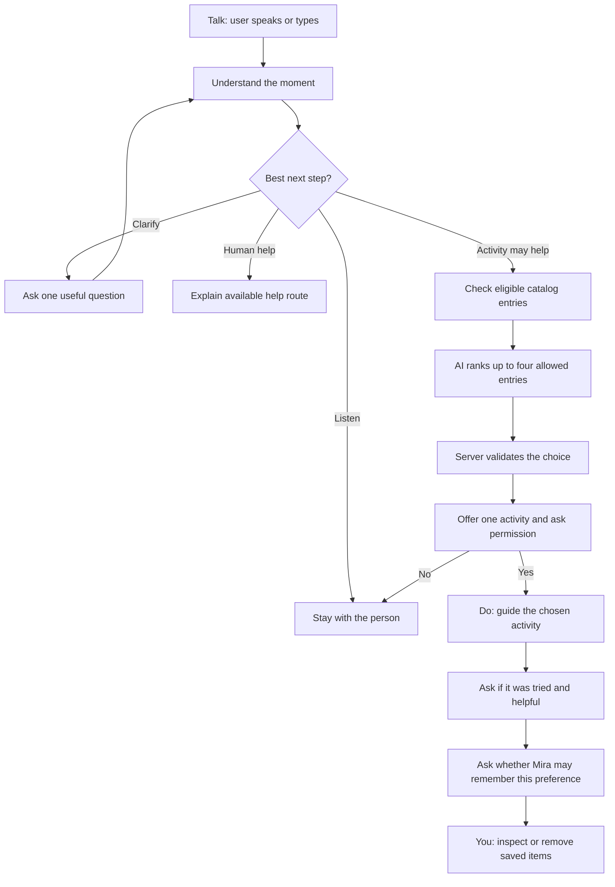
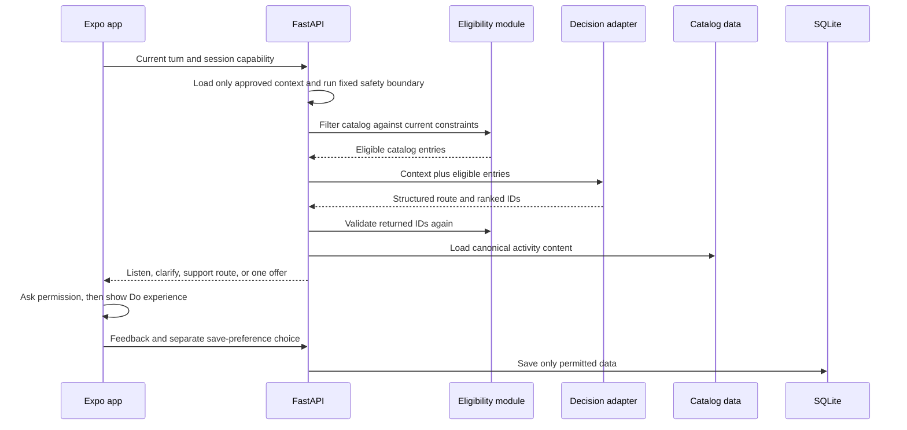

# Mira Product Requirements

**Status:** Existing Android app. This document defines V0.03 contracts and completion criteria. The approved activity catalog and Actions/Continue extension are specified by the [Nine Activities Master Blueprint](Mira_Nine_Activities_Master_Blueprint_v2.1.md), revision 2.2. Acceptance remains to be verified.
**Date:** 2026-10-19
**Audience:** Mira builders; Mpower product and clinical reviewers  
**Use:** Current evaluation uses private, synthetic data. This operating restriction does not lower the quality required of the app's core workflows. Public use requires separate review.  
**Engineering plan:** [Product review and implementation plan](product_engineering_review.md). Estimates will follow the agreed implementation slices.

> The proposal called this V0.02, but the repository already defines V0.02 as the installed fixed-action demo. V0.03 is the next-build label so the two scopes stay clear.

## 1. Product

Mira helps someone through a difficult moment. It listens, decides whether to keep listening or suggest one suitable activity, asks permission, guides the activity, then asks whether it helped.

The person should be able to arrive with a messy thought, feel understood, and leave with either more clarity or one manageable next step. Listening is a complete outcome. An activity is useful only when it fits what the person wants.

The product hypothesis is:

> Can Mira help someone talk through an everyday difficult moment and, when wanted, follow through on one relevant activity?

### Quality required in this version

- Voice and text carry the same conversation across mode changes and temporary disconnection. The app accurately indicates recording, output, connection, and saving states.
- Each of the nine included activities provides a complete usable interaction: needed input, editable work, useful pacing, applicable pause/stop controls, and a return to Talk. Showing instructions and a Done button alone is insufficient when the activity asks the person to write or choose something.
- Returning from Do preserves the current Talk session. Feedback is optional, and leaving never requires saving a preference.
- Journal saving, excerpt sharing, and preference saving each communicate what will be retained and require their own explicit choice. Failed writes preserve the draft and offer recovery.
- Routine screens use concise product language. Explain processing, retention, and service limitations where they affect a decision; keep development instructions and diagnostics out of ordinary use.
- Core behavior works without a scripted conversation or developer assistance. The exact emergency sentence below is a bounded verification fixture and must never be treated as general crisis detection.

Private evaluation, synthetic data, and the unconnected support route remain operating constraints. They do not justify fake success states, incomplete interactions, or scattered activity-specific implementations.

Mira is not a therapist. It does not diagnose, provide treatment, claim clinical benefit, reliably detect crisis, or contact a person on the user's behalf.

## 2. What changes from V0.02

| Current V0.02 demo | V0.03 target |
|---|---|
| Two fixed activities and their flow | A versioned catalog of nine activities |
| Model selects from two choices | A replaceable selector proposes and ranks catalog IDs; the server checks them |
| Activities run inline as fixed Talk branches | The selected activity opens a focused Do experience |
| Talk and Journal destinations | Talk and You destinations; Do opens for the active activity |
| Feedback is tied to current actions | Ask whether the activity was tried, helpful, and welcome again; save future-use preference only with consent |

Do not build a separate workflow for every feeling or life situation. The same activity can fit different moments.

## 3. Main flow



Mira offers at most one activity at a time. The person can say no, pause, stop, or return to Talk at any point. Listening is a valid outcome; Mira does not need to produce an activity every time.

## 4. Main surfaces

- **Talk:** Main entry. Voice and text conversation, one useful question at a time, a brief explanation for a suggestion, and permission before starting it.
- **Do:** A focused screen for the activity currently being tried. It opens from an accepted Talk offer or the Activities library and returns to its origin when finished or stopped.
- **You:** Journal, saved memories and preferences, and any activity history the person chose to save. Journal entries remain private unless the person separately shares an excerpt.
- **Activities:** A permanent, static library of the nine catalog activities, plus a separate Continue shelf containing only work the person explicitly chose to keep. Continue data is device-local. Starting, completing, or browsing an activity does not save it automatically. The full entry, resume, retention, and return behavior is defined in the Nine Activities Master Blueprint.

Open to Talk. Keep the interface calm and simple. Do not add a wellness dashboard, mood tracker, or feed.

## 5. Activity catalog

Use the nine neutral prototype activities and exact user-facing catalog in the Nine Activities Master Blueprint. This replaces the earlier V0.03 proposal below, including its former activity IDs and names. `Listen only`, `Ask a question`, and `Human support` remain decision outcomes or routes, not catalog activities.

| ID | Activity | How it happens | Needs another person? |
|---|---|---|---|
| `grounding` | Notice what is around you | Guided sensory noticing | No |
| `paced_breathing` | Follow a comfortable rhythm | Single-shape visual guide or own pace | No |
| `brain_dump` | Get it out. Keep it messy. | Temporary in-app writing; optional verified hold-to-speak extension | No |
| `one_small_step` | Make one thing easier to start | Task slips, bucket sort, and one next action | No |
| `name_a_feeling` | Find words for this moment | User-selected feeling words and optional thought check | No |
| `unsent_letter` | Write what you wish you could say | Temporary letter editor and explicit optional save | No |
| `reach_out` | Find the words to ask someone | Editable message draft; user decides whether to copy or contact | Yes |
| `short_movement` | Take a small break where you are | User-chosen offline break | No |
| `one_song_break` | Give yourself one song | User-directed external handoff and return | No |

The blueprint is the detailed activity specification for copy, input, exit, retention, and visual behavior. It extends the existing V0.03 contracts; it does not replace Talk, Journal, voice, privacy, Help, or server consent boundaries in this PRD.

Delivery modes can overlap: an activity may be mental, guided by software, done in the world, or involve another person. Store these as tags and requirements, not as mutually exclusive product categories. Mira may help draft a message, but it must not send one.

Each catalog entry is structured data, not a hard-coded conversation branch. It contains:

- Stable ID, catalog version, title, and short purpose.
- Situations it may fit and delivery-mode tags.
- Canonical steps, duration, effort, and environment or equipment needs.
- Prerequisites, whether another person is needed, and any reviewed exclusions.
- Review status and source; personalization signals; start, stop, and completion signals.

Prototype wording stays neutral and non-clinical. Use these review states: `draft` (never eligible), `demo_approved` (neutral content for the private synthetic demo), `clinician_reviewed` (may be considered for a future pilot after Mpower approval), and `inactive` (never eligible). Mpower clinicians must review suitability, wording, and offering rules before public use. Do not present a prototype activity as treatment.

### How an activity gets offered

1. Mira's product team writes the activity and its plain-language steps in the catalog.
2. A reviewer checks the wording, intended use, and exclusions, then records its review status.
3. FastAPI filters out entries that are inactive, not allowed for this demo, or do not fit the current constraints.
4. GPT ranks only the remaining entries. FastAPI checks the IDs again and supplies the approved catalog text.
5. The person decides whether to try the one activity Mira offers. Their feedback changes future suggestions only if they separately allow Mira to save that preference.

The model does not add activities to the catalog or approve its own content.

## 6. Selection rules

The selector may return only structured data: a short situation summary, one next-step choice (`listen`, `ask_question`, `offer_activity`, or `human_support`), a question if needed, and up to four ranked catalog IDs. It may not write new activities, steps, or safety rules.

The backend:

1. Loads only catalog entries allowed for this demo and removes entries that fail deterministic eligibility checks.
2. Sends the eligible entries and permitted context to the decision adapter. GPT proposes and ranks up to four IDs.
3. Rejects unknown, duplicate, inactive, or ineligible IDs and retrieves the canonical activity text from the catalog.
4. Offers the top valid entry only after Mira asks and the person agrees.

If no valid activity remains, or selection fails, Mira listens or asks one question. It must not invent a substitute. A refusal returns to Talk without pressure.

Eligibility checks can enforce catalog status, prerequisites, environment requirements, explicit user preferences, and allowed delivery modes. They are ordinary deterministic rules. They are not clinical screening and must not claim to identify whether a person is safe.

## 7. Do experiences

Refactor the existing activity runner around the following reusable presentation patterns, with activity content supplied by the catalog:

- **Capture and choose:** Brain Dump and Task Reset. User text stays editable; any sorting preserves every original line and leaves the final choice to the user.
- **Step by step:** Grounding, Name a Feeling, and Sleep Wind-down.
- **Choose and try:** Tiny Next Step, Short Movement, and Pause. A timer is optional and always user-controlled.
- **Prepare and act:** Reach Out helps the user decide what they want to say; the user makes contact themselves.

Show clear Start, Skip, Pause, Stop, and Done controls where relevant. Do not treat opening or completing an activity as proof that it helped.

## 8. Outcome and memory

After an activity, ask:

1. Did you try it or stop early?
2. Did it help: **not at all / a little / quite a bit**?
3. Would you like Mira to suggest it again in a similar moment?

Keep this feedback and the activity history in the current session unless the person explicitly agrees to save it for future suggestions. Show the exact preference before saving it. The person can view, revoke, and delete saved preferences in You. A `no` or `not now` is respected and does not trigger a repeat offer.

Memory remains limited to useful preferences, for example “usually wants to talk before acting” or “short walks can help when stuck.” Do not save raw conversation, brain dumps, or inferred personal traits. Journal saving, sharing an excerpt with Talk, and saving a future activity preference are separate consent choices.

## 9. Backend and AI design

Keep one FastAPI service. Separate the three responsibilities into files so catalog edits, model changes, and eligibility rules can be reviewed independently:

```text
server/
  app.py                         API routes, session, consent, orchestration
  store.py                       existing SQLite persistence
  interventions/
    catalog.py                   versioned canonical activity data
    decision.py                  replaceable selector interface and GPT adapter
    eligibility.py               deterministic eligibility checks
```



The decision adapter is the only model-specific boundary. Use GPT for V0.03. Keep the input/output contract independent of GPT so a later model such as Jev can replace it without changing catalog data or eligibility. Do not build Jev, agents, a second service, or a model comparison now.

FastAPI continues to own session checks, consent, catalog validation, persistence, and tool execution. The model never supplies a user ID, bypasses consent, or writes directly to SQLite. Keep the existing server-side API key and expiring session capability rules.

## 10. Voice, privacy, and help boundaries

- Keep OpenAI Realtime and the existing React Native WebRTC path for voice.
- Mic is off by default. Preserve explicit hold-to-talk: set `turn_detection: null`, enable the mic only while held, clear the input buffer on press, cancel and clear Mira's output when interrupted, then commit input and request a response on release. No automatic voice detection.
- If voice disconnects, preserve the visible conversation and offer Retry voice or Continue with text through the existing OpenAI/FastAPI path. If the provider or server is unavailable, say Mira is temporarily offline; keep Journal drafts and previously loaded activity content usable.
- Do not retain raw Talk transcripts or raw voice audio. Journal voice transcripts are editable before save. Journal entries are private by default; the person selects and edits an excerpt, then separately approves it before Talk can retrieve it. Show the source. Revocation or deletion blocks future retrieval.
- Use one synthetic demo user with no account creation. Keep the existing demo reset so saved Journal, memory, and activity data can be cleared.
- Use synthetic, non-urgent data for the demo. Do not log journal text, saved preference text, voice content, or credentials.
- Keep the existing persistent Help control and accurately labeled support placeholder. No Mpower connection, clinician directory, live handoff, monitoring, or reliable crisis detection is included.
- Preserve the exact scripted emergency demo behavior from V0.02: only the recognized sentence `I am in immediate danger and need emergency help now.` stops voice output and shows “This demo is not crisis support and is not connected to Mpower. Contact local emergency services or someone you trust now.” This is not general crisis detection. Do not replace it with an AI safety classifier or claim comprehensive screening.
- Keep the OpenAI long-lived key on the server; return only short-lived session credentials and require the existing expiring demo-session capability for relayed tools and writes. This remains a private-demo boundary, not production authentication.
- Do not use Mpower branding or imply clinical endorsement without approval. Keep controls accessible: at least 48 dp targets, screen-reader labels and state announcements, and state cues that do not rely on color alone.
- Before any public pilot, get Mpower clinical, privacy, security, and legal review of catalog content, consent, retention, and operating responsibilities.

## 11. Failure behavior

| Failure | Mira behavior |
|---|---|
| Selector unavailable or invalid output | Do not show an activity; continue listening or ask one question. |
| No eligible catalog entry | Keep talking; do not force a suggestion. |
| User declines or stops | Return to Talk and respect the choice. |
| Saving feedback fails | Keep the current screen usable and offer Retry; do not claim it was saved. |
| Realtime voice disconnects | Preserve visible context; offer Retry voice or text. |
| API/provider unavailable | Label Mira temporarily offline; retain local drafts and previously loaded activity content. |

## 12. Acceptance checks

V0.03 is ready for a private demo when:

- A person can start in Talk by voice or text and reach listen, clarify, one activity offer, or the help route.
- GPT can propose and rank only IDs from the eligible catalog; FastAPI rejects invalid IDs and returns canonical steps.
- Mira asks permission before the Do experience. The person can decline, pause, stop, and return to Talk.
- At least one experience from each reusable Do pattern works; catalog data selects the activity content.
- Feedback asks whether the activity was tried, whether it helped, and whether it may be suggested again.
- No future preference is saved without an explicit yes; saved preferences can be inspected, revoked, and deleted in You.
- An invalid selector response, no eligible activity, and a server outage never lead to invented activities or false success messages.
- Existing hold-to-talk, interruption, text fallback, Journal controls, persistent Help, and synthetic-data boundaries still work on the installable Android build.

Keep verification focused: a few server contract checks for eligibility, structured output, consent, and deletion; one end-to-end check on the primary OnePlus Android phone. Record Android version for the voice check. Do not add broad test infrastructure or require physical-device testing for every change.

## 13. Build order

1. Define the nine catalog records and review/status fields.
2. Add eligibility checks and the structured decision adapter inside the existing FastAPI service.
3. Connect Talk to the new one-at-a-time decision flow while preserving voice and text recovery.
4. Build the reusable Do patterns and the You view for saved preferences/history.
5. Add the outcome loop, consented preference persistence, and focused checks.
6. Run one complete synthetic walkthrough on Android and review activity wording with Mpower before any wider use.

## 14. Not in this build

- More than the nine initial activities; an open-ended or AI-authored activity catalog.
- Jev, multi-agent selection, learned ranking, or model comparison.
- Separate flows for diagnoses or individual emotional situations.
- Clinical treatment content, crisis screening, clinician dashboards, human integrations, message sending, or a connected Mpower support route.
- Public launch, pilot, user accounts, analytics, production hosting, or a second backend service.
- Broad RAG, vector search, a general mental-health knowledge base, or automatic storage of conversations.

## 15. Decisions

- **Backend shape:** Separate catalog data, decision adapter, and deterministic eligibility modules inside the existing FastAPI service. The user selected this option on 2026-10-14.
- **Next version label:** V0.03 distinguishes this build from the existing V0.02 demo.
- **Initial catalog:** Nine neutral prototype activities; listening and human support are routes, not activities.
- **Selection:** GPT proposes and ranks IDs; backend filters and validates; Mira offers one activity and asks permission.
- **Future learning:** Save a preference only after explicit user consent.

## Historical review — superseded by the 2026-10-15 review

The following findings belong to an earlier implementation snapshot. Several corresponding controls and catalog fields now exist. This table is retained as history, not a current blocker list. See [the current review](product_engineering_review.md) for evidence and the implementation sequence.

| Priority | Finding | Evidence |
|---|---|---|
| P1 | `reach_out` says it helps prepare what to say, but the Do screen has no message/preparation input. | `server/interventions/catalog.py:88-96`; `mobile/src/InterventionRunner.tsx:192-206` |
| P2 | Activity steps have no pause/resume control; only the optional timer can pause. | PRD:126; `mobile/src/InterventionRunner.tsx:199-206` |
| P2 | Feedback-save failure has no Retry action, despite the PRD requirement. | PRD:201; `mobile/src/InterventionRunner.tsx:122-138` |
| P2 | Catalog records lack the required situation-fit field, and the selector receives no situation-fit or personalization signals. | PRD:85; `server/interventions/catalog.py`; `server/interventions/decision.py:70-73` |
| P1 | The required installable Android walkthrough and voice gate on the OnePlus are still pending; unit checks cannot establish device readiness. | PRD:216-218; project QA status |

These historical findings must be rechecked against the current code before being used as tasks.

