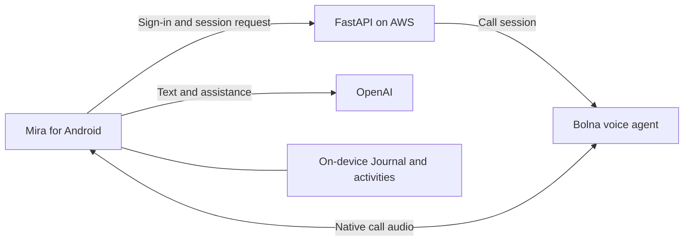

<p align="center">
  
</p>

<p align="center"><strong>When words feel hard, start with a call.</strong><br>A companion to help you talk things through, make room to write, and find one small next step.</p>

<p align="center">
  <a href="https://github.com/sandip-pathe/mira/releases/download/v1.0.0/Mira-Android-v1.0.0-build-2.apk"></a>
  <a href="https://sandip-pathe.github.io/mira/"></a>
</p>

<p align="center"><a href="https://github.com/sandip-pathe/mira/releases">All releases</a> · <a href="https://github.com/sandip-pathe/mira/releases/tag/v1.0.0">Release notes</a></p>

<p align="center">
  
</p>

## Meet Mira

Mira makes it easier to begin when explaining everything feels like too much. You can call, type, write privately, or choose a small activity. There is no required next step.

| ☎️ Call Mira | 💬 Talk | 📓 Journal | ✨ Activities |
| --- | --- | --- | --- |
| A natural voice conversation with Mira, powered by Bolna. | Text chat and hold-to-talk voice, powered by OpenAI. | Write and revisit entries stored on the device. | Nine optional ways to pause, reflect, or find a next step. |

Journal entries stay on the device. Mira receives only the context you choose to share. Call audio is not automatically added to Talk or Journal.

## Bolna × Mira

<p>
  <a href="https://www.bolna.ai/">
    
  </a>
  <br>
  <strong>Powered by Bolna</strong>
</p>

Mira's **Call Mira** feature is an in-app voice conversation built around Bolna's voice agent for the [Bolna Symphony Buildathon](https://www.bolna.ai/symphony/buildathon).

- Talk naturally with Mira's Bolna agent, which uses her calm, warm companion personality.
- Use a native caller screen with connection states, a call timer, mute, audio routing, minimize, and hang-up controls.
- Start a call with only the selected, limited Talk context and approved preferences sent with the session.
- After a failed call, continue your existing text conversation in Talk. Call speech is not copied into Talk or Journal.

FastAPI verifies sign-in and requests a short-lived Bolna session. The app connects through SIP signaling and native WebRTC audio. Provider credentials stay on the backend. See the [Mira agent prompt](docs/bolna-mira-agent-prompt.md), [agent configuration](server/bolna_agent_config.json), and [native call notes](docs/bolna-native-call-progress.md).

## How it works



Built with React Native · Expo · Firebase Auth · FastAPI · Bolna · OpenAI · SQLite

## Install on Android

Use the green **Download for Android** button above, or visit the [Mira v1.0.0 release page](https://github.com/sandip-pathe/mira/releases/tag/v1.0.0).

1. Open the APK on your phone to install Mira.
2. If Android asks, allow installs from your browser.
3. Sign in or create an account to use Mira.

To update Mira, manually install the APK from a newer release.

## Run locally

You need Node.js and npm, Python 3.12 or later, `uv`, and credentials for the configured Firebase, OpenAI, and Bolna services.

1. Copy `server/.env.example` to `server/.env` and add the provider keys.
2. From the repository root, create a virtual environment, install the dependencies, and start FastAPI:

   ```powershell
   uv venv server/.venv
   uv pip install --python server/.venv/Scripts/python.exe -r server/requirements.txt
   server/.venv/Scripts/python.exe -m uvicorn server.app:app --host 0.0.0.0 --port 8000
   ```

3. In `mobile`, install packages with `npm ci`.
4. With a development APK installed, run `npx expo start --dev-client --tunnel` from `mobile`.

The submission APK uses the HTTPS API endpoint configured in `mobile/eas.json`. To create a newer standalone APK, run `npx eas-cli build --platform android --profile submission` from `mobile`. Attach the APK to a [new GitHub Release](https://github.com/sandip-pathe/mira/releases/new).

## Project links

- [Pitch deck](https://sandip-pathe.github.io/mira/)
- [Android downloads and release history](https://github.com/sandip-pathe/mira/releases)
- [Bolna Symphony Buildathon](https://www.bolna.ai/symphony/buildathon)
- [Product and engineering work orders](PRD/mira_submission_build_work_orders.md)

<p align="center"><sub>Made for moments when starting is the hard part.</sub></p>
