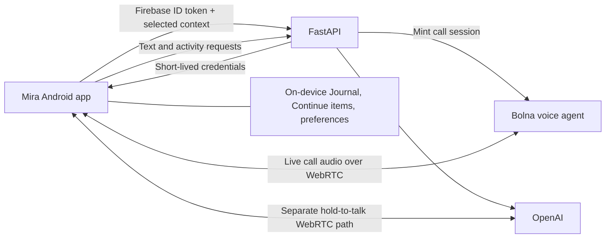

<p align="center">
  
</p>

<p align="center"><strong>When words feel hard, start with a call.</strong></p>
<p align="center">A companion for talking things through, making room to write, and finding one small next step.</p>

## Product launch video

**[Watch Mira — video coming soon](https://example.com/mira-product-launch-video)**

The product recording will go here. This is a placeholder link.

<!-- Replace the video URL above with the final public recording. -->

<p align="center">
  
</p>

## Try Mira on Android

**[Download the Android APK — coming soon](https://example.com/mira-android.apk)**

The standalone APK will be linked here when ready. This is a placeholder, not an installable download. Review access uses an existing account; credentials are supplied privately with the submission.

<!-- Replace the APK URL above with the final standalone EAS artifact or release download. -->

## Meet Mira

Some days, even explaining what is on your mind feels like work. Mira gives you a place to begin without preparing a perfect prompt or committing to a program.

Call Mira and talk naturally. Write something down in Journal. Try a short activity if that feels useful. A conversation can be enough; there is no required next step.

### Talk, write, or try something small

| Experience | What it offers |
| --- | --- |
| **Call Mira** | An in-app voice call powered by Bolna, with a dedicated caller screen, connection states, mute, audio-route selection, minimize, and hang-up controls. |
| **Talk** | Text chat and explicit hold-to-talk: hold to speak, release to listen. These paths use the existing OpenAI integration. |
| **Journal** | A space to write, save, and reopen text entries on the device. Journal has no microphone, voice recording, or AI follow-up. |
| **Activities** | Nine optional ways to pause, reflect, or find a manageable next step. |

The activity library includes **Grounding, Paced Breathing, Brain Dump, One Small Step, Notice & Name, Unsent Letter, Reach Out, Move / Change Your Scene, and One Song Break**. People choose what to try and when to stop.

Journal drafts, saved entries, Continue items, and explicit activity preferences live on the device. A person can separately approve an excerpt or preference for use in a conversation. Calls receive a small snapshot of selected context, rather than access to the private Journal.

<!-- Add actual app screenshots and walkthrough links here when supplied. -->

## Bolna × Mira

<p>
  <a href="https://www.bolna.ai/">
    
  </a>
  <br>
  <strong>Powered by Bolna</strong>
</p>

Mira is being submitted to the **[Bolna Symphony Buildathon](https://www.bolna.ai/symphony/buildathon)**. The build-and-submit window is **15–31 October 2026**, with the finale at Symphony on **20 November 2026**.

Mira began as a companion app before the Buildathon. The submission adds **Call Mira**, a Bolna-powered voice experience inside that app.

### What we built with Bolna

- **An in-app call:** speak with Mira from the Android app without placing a phone-number call.
- **A distinct caller experience:** connecting, provider-reported ringing, connected, reconnecting, ended, and failed states, with call duration and retry.
- **Android call integration:** native audio, a minimized call bar, mute and audio controls, and notification actions to return to or end the call.
- **Context at the start of a call:** a bounded selection of recent Talk messages, approved excerpts, and saved preferences, passed into the Bolna agent's session data.
- **A way back to Talk:** after a failed call, continue with the existing text conversation. Call-only speech is not automatically imported into Talk or Journal.

The Bolna agent follows Mira's conversational prompt. The app asks FastAPI for a short-lived call session, then connects to Bolna using SIP signaling over a secure WebSocket and native WebRTC audio. The account API key stays on the backend. This implementation uses SIP.js with a native media adapter; it does not put the browser SDK inside a WebView.

The [agent prompt](docs/bolna-mira-agent-prompt.md), [reusable agent configuration](server/bolna_agent_config.json), and [call implementation notes](docs/bolna-native-call-progress.md) describe the current integration. Product screenshots and the final call walkthrough will be added when available.

**Current status:** the Bolna browser conversation works, and an earlier Android development build compiled. The current call flow and speaker routing are implemented in source; device verification is intentionally deferred. The standalone APK remains blocked on hosting the backend at a stable HTTPS address.

## A little about the technology

Mira is a React Native / Expo Android app with a FastAPI backend. Firebase provides email/password sign-in. Device storage uses SQLite and local files. Bolna runs Call Mira; OpenAI supports text, hold-to-talk, and optional activity assistance.



FastAPI handles authentication, call-session creation, and model-backed workers. Call audio goes between the app and Bolna; FastAPI is not an audio relay. The app selects approved context locally before requesting a session. Calling, Talk, Journal, and Activities remain separate surfaces; a call does not automatically start an activity or save a transcript.

| Part | Current implementation |
| --- | --- |
| Mobile | Expo SDK 57, React Native 0.86, React 19, TypeScript, Expo Router |
| Calling | Bolna, SIP.js, React Native WebRTC, Android CallKeep integration |
| Authentication | Firebase email/password accounts and backend ID-token verification |
| Backend | Python / FastAPI; authenticated worker endpoints |
| Local data | Expo SQLite and device files |
| Other AI paths | OpenAI Realtime for hold-to-talk; Responses-backed text and assistance workers |

## Pitch deck

**[Read the five-slide PDF](submission/deck/Mira-Symphony-Buildathon.pdf)** · **[Reveal.js HTML deck](submission/deck/index.html)** · [Deck assets and notes](submission/deck/README.md)

GitHub displays the HTML source rather than running the presentation inside the README. Download the deck folder and open `index.html` in a browser, or read the text version below. The folder includes copies of the artwork used by the deck.

<details>
<summary><strong>The pitch, in five slides</strong></summary>

### 1. When words feel hard, start with a call

Mira is a voice-first companion for everyday difficult moments. Talk it through and find one small next step when you are ready.

### 2. Start talking. Choose what helps next

Call Mira, type, or hold to talk. Journal offers space to write; Activities offer optional small exercises. People move between these when they choose.

### 3. Bolna powers the call. The app shapes the experience

FastAPI creates an authenticated call session. The Android app connects to the Bolna voice agent with native audio. OpenAI remains in the separate text and hold-to-talk paths.

### 4. A call screen built for a real conversation

The implemented caller flow includes connection states, mute, audio routing, minimize, and hang-up. Physical Android verification is deferred and is not presented as completed.

### 5. Try Mira. Tell us where voice helps

The app brings together Bolna calling, Talk, local Journal drafts, and nine optional Activities. The standalone APK depends on backend hosting; physical call verification is deferred. The question behind Mira: can a voice-first companion make it easier to begin?

</details>

## Run Mira locally

### Containerized API

The root `Dockerfile` packages FastAPI and the shared activity catalog. From the repository root, build and run it with `docker build -t mira-api .` and `docker run --rm -p 8000:8000 --env-file server/.env -v mira-review-data:/data mira-api`. The named volume preserves the review-budget ledger across container replacement. Hosted deployments should provide provider/reviewer values as host secrets, mount persistent storage at `/data`, and run one process/replica while voice relay state remains in memory. The image exposes `/health`; host selection, deployment, and live verification remain pending.

You need Node.js / npm, Python 3.12+, `uv`, provider credentials, and access to the configured Firebase project. Native calling requires a development APK; Expo Go cannot supply the app's native call modules. The EAS cloud-build path does not require Android Studio or a local Android SDK.

### 1. Configure the backend

Create `server/.env` from [`server/.env.example`](server/.env.example) if it does not already exist, then fill in:

| Setting | Purpose |
| --- | --- |
| `OPENAI_API_KEY` | Talk text, hold-to-talk, and optional assistance/transcription paths |
| `BOLNA_API_KEY` | Server-side Bolna account access |
| `BOLNA_AGENT_ID` | The configured Mira voice agent |

Keep provider secrets in `server/.env`, never in `EXPO_PUBLIC_*` variables or the APK. The example also documents reviewer access, usage allowances, and budget settings. Local development leaves reviewer mode disabled by default.

From the repository root:

```powershell
uv venv server/.venv
uv pip install --python server/.venv/Scripts/python.exe -r server/requirements.txt
server/.venv/Scripts/python.exe -m uvicorn server.app:app --host 0.0.0.0 --port 8000 --no-access-log
```

Health endpoint: `http://127.0.0.1:8000/health` on the development computer.

### 2. Set up sign-in

The Firebase web-app configuration is in [`mobile/src/shared/firebase.ts`](mobile/src/shared/firebase.ts). The backend verifies tokens for the same project in [`server/firebase_auth.py`](server/firebase_auth.py). Enable Email/Password in Firebase Authentication and provision an account. The app currently signs in existing accounts; it does not offer public account creation. Firebase environment variables and a service-account key are not required by this implementation.

### 3. Build and install the development APK

```powershell
cd mobile
npm ci
npx eas-cli login
npx eas-cli build --platform android --profile development
```

Install the APK from the EAS build link on the Android phone. EAS manages the signing key. Changes to native call modules or config plugins require a new APK; restarting Metro is not enough.

### 4. Start Metro

With FastAPI still running, start Metro from `mobile`:

```powershell
npx expo start --dev-client --tunnel
```

Open the returned development-client link with Mira installed. Keep FastAPI, Metro, and the tunnel running. Tunnel worker traffic passes through Metro to local FastAPI; direct LAN development uses the computer's address on port 8000. `127.0.0.1` on the phone points to the phone itself.

### Standalone Android APK

The `development` profile needs Metro. To create an APK that runs independently:

1. Deploy the backend to a stable HTTPS origin.
2. Set `expo.extra.apiUrl` in [`mobile/app.json`](mobile/app.json) to that origin.
3. From `mobile`, run `npx eas-cli build --platform android --profile offline-gate`.

The `offline-gate` profile requires an HTTPS API URL and excludes the development-only cleartext HTTP plugin. It does not need Metro, but calls and AI requests still need an internet connection and the hosted backend.

The root [Dockerfile](Dockerfile) packages FastAPI and the shared activity catalog. Run one server process/replica: temporary voice state and rolling request limits are process-local. In reviewer mode, mount persistent storage for `MIRA_BUDGET_DB_PATH`, configure the reviewer allowlist/access deadline, and set the provider-side budget and call limits. See the [submission work orders](PRD/mira_submission_build_work_orders.md) for the remaining hosting and release steps.

## Offline behavior and development notes

- **Available locally:** Journal browsing, writing, saving, reopening, and deletion; bundled Activities; saved Continue items and explicit preferences.
- **Needs a connection:** Call Mira, Talk AI, optional task sorting, and Brain Dump's transcription-only held speech. Journal has no speech-capture path.
- **Conversation lifetime:** default Talk history and active moment state stay in app memory for retry or text continuation. Task dumps are not stored as default Talk history. Call-only speech is not imported into Talk.
- **Context choices:** only selected approved excerpts and opted-in preferences are sent to workers. Sharing can be revoked or deleted in Journal. Helpful activity lessons are shown before saving and stay off unless the person opts in.
- **Storage:** `mira-private.db` holds SQLite-backed local records. Legacy JSON imports are validated transactionally; failed imports retain their source. Older APKs without the SQLite module need an update. Android backup/transfer exclusions are generated; iOS backup exclusions remain pending.
- **Retired APIs:** private Journal, memory, feedback, activity-catalog, and activity-run server APIs are retired. The legacy test database was deleted without import. Historical voice-note references may remain locally, but Journal no longer records or plays voice notes.

The shared catalog is [`mobile/assets/catalog/activities.json`](mobile/assets/catalog/activities.json). Both the app and Python selector read it; server deployment packages must include it. Current surfaces expose the nine canonical activities, while aliases remain for compatible legacy records.

Normal worker limits are 120 requests/minute and 10,000/day per account, with a 1,000/minute process-wide cap. Reviewer mode adds an allowlist, access expiry, durable OpenAI budget reservations, and tighter per-account allowances. It disables direct OpenAI Realtime and Brain Dump transcription; Bolna call minting has its own allowance and cooldown. The requested provider-side call-duration limit still needs verification. These controls and remaining release decisions are recorded in the submission work orders.

## Focused checks and deferred device verification

From the repository root:

```powershell
server/.venv/Scripts/python.exe -m unittest server.test_contract server.test_offline_cutover server.test_bolna
```

From `mobile`:

```powershell
npx tsc --noEmit
node tests/voice-gate.cjs
node tests/activity-catalog.cjs
node tests/activity-run.cjs
node tests/bolna-call.cjs
npx expo export --platform android
```

`node tests/device-storage.cjs` (Node 24+) covers SQLite import, rollback, and restart. `node tests/device-backup.cjs` checks Android backup resources. The optional live provider probe, `server/.venv/Scripts/python.exe -m server.probe_provider`, uses synthetic inputs and real provider events.

Automated checks do not establish physical Android audio behavior. As requested, the OnePlus walkthrough is deferred; when device verification resumes, it should cover sign-in, two-way call audio, mute/routing, minimize/return, cancellation/retry, Talk hold/release, Journal save/reopen, and offline Activities. Full coordination between the separate Bolna and OpenAI audio sessions remains tracked in [`TODOS.md`](TODOS.md).

## Project references

- [Product requirements](PRD/mira_prd.md)
- [Submission build work orders](PRD/mira_submission_build_work_orders.md)
- [Call implementation and verification record](docs/bolna-native-call-progress.md)
- [Nine-activity device checklist](docs/nine_activity_demo_checklist.md)
- [Offline-first plan and ledger](PRD/mira_offline_first_plan.md)
- [Activity upgrade proposal](PRD/mira_activity_upgrade_plan.md)
- [Deferred work](TODOS.md)

Implementation documentation: [Bolna Web Call](https://github.com/bolna-ai/web-call), [OpenAI WebRTC](https://developers.openai.com/api/docs/guides/voice-webrtc?api=realtime), [OpenAI push-to-talk](https://developers.openai.com/api/docs/guides/realtime-conversations#push-to-talk), [React Native WebRTC](https://react-native-webrtc.github.io/handbook/guides/basic-usage.html), [Expo audio](https://docs.expo.dev/versions/v57.0.0/sdk/audio/), and [EAS development builds](https://docs.expo.dev/develop/development-builds/create-a-build/).
