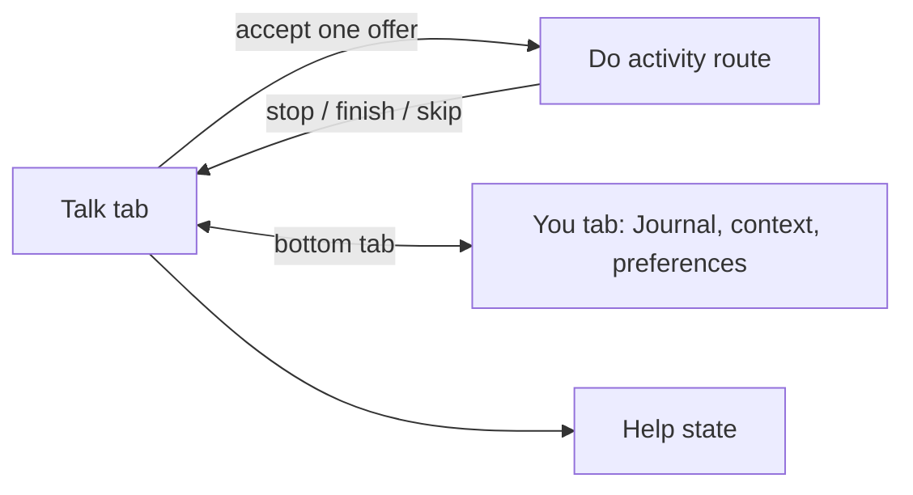

# Mira UI review

Review basis: source inspection of `src/Mira.tsx`, `src/InterventionRunner.tsx`, `src/YouScreen.tsx`, `src/Journal.tsx`, `src/ui.tsx`, `CURRENT_UX.md`, and the V0.03 design requirements. This was not a screenshot-based visual audit; no browser automation surface is connected in this session.

## App map

Three destinations, two permanent tabs. Journal is part of You. Do is temporary and opens only after accepting the single activity offer.

## Findings

1. **Talk currently reads as a stack of cards, not a call screen.** The scroll view contains the moment, privacy notice, approved excerpts, connection recovery, captions, and activity offer. The design brief asks for a spacious session canvas with temporary content. Keep the same information available, but give it a clearer order and reduce the persistent card stack.
2. **Voice and text controls do not share a stable layout.** The voice view has a hold-to-talk button and Cancel turn; after choosing text, that control area disappears and a composer appears in the scroll. The brief asks for stable mic, end, and type controls with text available throughout. Prototype the layout while preserving hold-to-talk and mic-off-by-default.
3. **An offer can sit below the fold.** It is rendered inside the scroll content after conversation captions. Give the one optional offer a compact, easy-to-notice position, with Try and Not now equally clear. Do not add an activity chooser.
4. **The existing recovery states are useful.** Retry voice and Continue with text are already present, and Help states explain demo limits. Preserve them in the call-style layout and avoid implying a connected clinician or crisis service.

## Design directions

- **A · Quiet canvas:** no central character; hierarchy comes from type, copy, and controls.
- **B · Soft presence:** a restrained abstract shape, without making an orb the default.
- **C · Small companion:** a quiet illustrated presence that stays secondary to the conversation.

The prototype keeps the same flow and colors across directions so the presence treatment is the main comparison. It is exploratory; no visual direction is approved.

## Verification and limits

- Expo Web compiled the React Native prototype with the installed Expo 57 / React Native 0.86 toolchain.
- `tsc --noEmit` passed.
- Visual appearance, Android sizing, TalkBack, text scaling, and contrast in rendered states still need browser/device inspection. No production app screens were changed.
