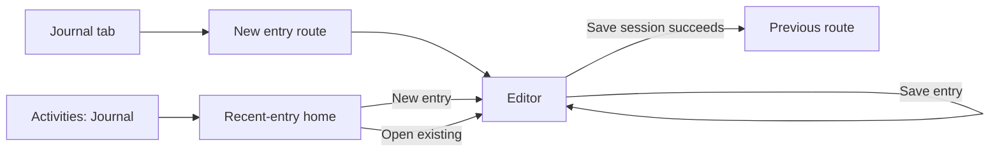

# Step 01 — Three-screen brief and behavior inventory

Completed: 2026-10-20. Basis: current native source, UI Lab source, and freshly captured lab screenshots. This is a design brief, not a native runtime verification. No visual direction has been selected.

## Shared brief

Mira helps a young adult talk, find something manageable to try, or write freely. The tone should feel like a thoughtful peer: personal, informal, direct, and supportive. The interface can be expressive and illustrated while leaving the next action clear. The user's feelings, name, or history must not be guessed for the sake of personalization.

Design three coherent systems for the same Talk, Activities, and Journal content and behavior. Colors, typefaces, icon treatment, art, visual hierarchy, and spacing remain open. The existing implementation is the control, not a mandatory design template.

| Surface | One purpose | Primary action | Secondary actions | Essential content |
| --- | --- | --- | --- | --- |
| Talk | Make it easy to begin and continue a conversation | Hold to speak; in text mode, write and send | Type/voice switch, captions, end voice, accept/decline one activity offer, Help | Presence, accurate recording/reply status, conversation when requested, one relevant offer, sources when shared context is used |
| Activities | Find a suitable activity quickly and return to kept work | Choose an activity | Resume/mark done/remove kept work, open saved outputs, Journal home, Help | Nine bundled activities, clear grouping/descriptions, opted-in preferences, existing kept-work sections |
| Journal | Put thoughts into words with an easy path to saving | Write and save an entry | Optional prompts, voice note, background/writing-size tools, save session, review prior writing and existing context controls | Prompt, editable draft, saved entries/follow-up thread, truthful local save status |

Keep navigation labels Talk, Activities, and Journal recognizable. The three directions may vary their visual composition, but must offer the same capabilities and show the same comparison content.

## 1. Talk

Source: [TalkScreen](../mobile/src/features/talk/TalkScreen.tsx), [session hook](../mobile/src/features/talk/hooks/useTalkSession.ts), [call controls](../mobile/src/features/talk/components/TalkCallControls.tsx), [offer](../mobile/src/features/talk/components/InterventionOffer.tsx).

The mic starts off. Pressing the mic starts a connection if needed; recording begins only when voice is ready and the press is still held. Releasing ends the turn. Holding while Mira speaks interrupts her. Selecting Type cancels voice capture and shows the existing conversation. Ending voice does not erase the visible conversation. Help opens the existing support choices; it is not a connected human chat service.

The caption toggle expands the voice conversation/context area and makes the presence hero compact. Its current implementation shows conversation messages, not a measured, word-synchronized two-line lyric stream. Do not describe a future visual caption concept as an existing native capability.

| State | Entry / transition | What the design must make clear |
| --- | --- | --- |
| Welcome / disconnected | App opens; mic is off | Start with hold-to-talk or Type; no recording implied by an animated hero |
| Connecting / reconnecting | Hold from disconnected/error, or reconnect attempt | Voice is getting ready; distinguish this from listening |
| Ready | Connection succeeds without a held press | Mic is available and off |
| Starting / recording | Hold while ready; keep holding | Capture starts, then listening is active; release sends |
| Finalizing / processing | Release | User capture has ended; Mira's reply is pending |
| Speaking | Audio reply arrives | Mira is speaking; holding the mic can interrupt |
| Voice error / turn error | Connection or turn fails | Retry by holding the mic, or switch to text; conversation remains available |
| Voice ended | End control | Voice is off; holding can restart it |
| Text empty / draft | Type selected | Comfortable text entry, clear voice switch and keyboard space |
| Text sending / reply pending | Send nonblank draft | Visible pending feedback; prevent duplicate sending |
| Text failed | Request fails | Preserve the failed content and offer retry |
| Activity offer | Valid suggestion arrives | One activity, short reason, Try it / Keep talking; no automatic launch |
| Conversation/context expanded | Captions selected or context shown in text | Readable transcript/source details without crowding the main control |
| Quiet return | Return from the music handoff | Voice stays paused until the person chooses Resume voice |

Return behavior: an accepted offer opens `/do` with `origin=talk`. Back returns to Talk with the conversation preserved; voice transport is stopped when the screen loses focus. An approved excerpt transfer fills the text composer for review rather than silently sending it.

Layout questions for research: how to balance hero and controls without a large dead zone; how recording differs from response animation; how offers, captions, and keyboard states fit without pushing the main action out of reach.

## 2. Activities

Source: [ActionsScreen](../mobile/src/features/actions/ActionsScreen.tsx), [bundled catalog](../mobile/assets/catalog/activities.json), [preference ranking](../mobile/src/shared/context/preferenceFeatures.ts), [activity route](../mobile/src/features/activities/ActivityRouteScreen.tsx).

The catalog is bundled and usable without a server fetch. Saved work and preference records load from the device on focus. Current screen order is header → nonempty kept-work sections → Choose an activity → Works for you → remaining groups. Thus preferred activities currently lead the library, but saved work may appear above the library on the page.

| Group | Current titles |
| --- | --- |
| Express | Journal entry point, Brain Dump, Unsent Letter, Notice & Name |
| Move forward | One Small Step, Reach Out |
| Take a break | Move / Change Your Scene, One Song Break |
| Follow a guide | Grounding, Paced Breathing |

Preferences: the latest explicit reuse setting per canonical activity determines promotion. Promoted items are sorted by newest preference first, with stable catalog order for ties, and removed from the regular groups to avoid duplicates. It is not a popularity score or an inferred emotional assessment.

Existing kept-work sections are Continue, Saved takeaways, Saved actions, and Saved wording. Continue offers Continue, Mark done, and confirmed Remove. The other sections open detail routes and offer confirmed removal. Saved letters are accessed inside Unsent Letter; do not copy the lab's global letter aggregation into the native requirements.

| State | Trigger | What the design must show |
| --- | --- | --- |
| Fresh library | No saved work or reuse preferences | Full library immediately; no empty dashboard or catalog loading gate |
| Preferred activity | Explicit reuse preference exists | Preferred activity visibly prioritized, once only |
| Kept work exists | Local records present | Recognizable resume/detail access, distinct from starting a fresh activity |
| Local read/update fails | Device operation fails | Specific recoverable status; bundled library remains usable |
| Returning from activity | Back/completion | Correct destination, refreshed local kept work/preferences |
| Journal entry point | Journal selected under Express | Open recent-entry home, with New entry available |

Return behavior: library and Continue launch `/do` with their distinct origins and optional item ID. The activity route returns these origins to Activities; Talk-origin work returns to Talk. Saved-output detail pages remain supporting routes, not new primary tabs.

Layout questions for research: make preferred choices easy to find, distinguish browse from resume, shorten scanning without hiding essential descriptions, and avoid making every item look like the same padded box.

Copy mismatch to resolve during synthesis: the bundled Reach Out summary still mentions copying, although the active Reach Out experience has no copy action. Describe the available draft/save behavior; this design work does not restore the deferred clipboard feature.

Source issue to carry into the handoff: Journal is rendered inside Express after a guard that skips fully promoted groups. If all Express activities are promoted, the current guard can hide the Journal entry point. The future design must retain its access; no code fix is included in this step.

## 3. Journal

Source: [entry screen](../mobile/src/features/journal/JournalEntryScreen.tsx), [home screen](../mobile/src/features/journal/JournalHomeScreen.tsx), [draft/session hook](../mobile/src/features/journal/hooks/useJournalDraftSession.ts), [mutations](../mobile/src/features/journal/hooks/useJournalMutations.ts), [follow-up](../mobile/src/features/journal/hooks/useJournalFollowUp.ts), [pickers](../mobile/src/features/journal/components/JournalPickers.tsx).

Journal is a writing session with entries and possible AI follow-up, not just one large text field. The editor shows an optional prompt picker and selected prompt before the first saved entry, draft input, voice-note controls, and existing supporting sections when applicable. Background selection also exposes writing-size controls. The native writing foreground is fixed at `#111111`; changing the background must not tint the writing.

Three different persistence states matter: queued local draft saving; Save entry appending writing and requesting a follow-up; and Save session finalizing the session. Save entry stays in the editor. Successful Save session returns via `router.back()`. A finalized session is read-only in the current screen. Never merge these into one “saved” state or imply an AI failure means the local save failed.

| State | Trigger | What the design must show |
| --- | --- | --- |
| New / empty | Journal tab or New entry | Ready to write, prompt optional, save disabled for blank text |
| Draft / keyboard open | Typing | Writing has priority; editor/caret and main action remain reachable |
| Prompt picker | Pick a Prompt | One picker, category/options, choose or dismiss; no writing loss |
| Appearance picker | Palette control | Background swatches and writing size; stable dark writing color |
| Local draft-save failure | Background write fails | Writing retained in memory; recovery status without false saved confirmation |
| Saving entry | Save entry pressed | Busy feedback and duplicate-write prevention |
| Entry saved / follow-up pending | Local append succeeds | Entry is already saved; AI follow-up is a separate pending action |
| Follow-up ready | Worker returns | Existing entry and follow-up readable; further writing possible |
| Follow-up unavailable | Worker fails | Saved writing remains; Retry follow-up is available |
| Recording voice note | Voice note then Stop | Recording state distinct from text and from Talk hold-to-speak |
| Unsaved voice note | Recording stopped | Save voice note or Discard; a separate save from writing |
| Saved voice note | Attachment save succeeds | Play/Pause and Delete access |
| Save session / finalized | Successful Save session | Finalized read state; return on success only |
| Entry/session save failed | Local write fails | Retain writing; show what failed and offer retry |
| Recent-entry home | Journal selected from Activities | New entry plus real drafts/saved sessions, dates/previews, empty state |
| Existing entry opened | Select recent session | Editable draft or finalized read state as appropriate |

Supporting capabilities to preserve in later state designs: deleting entries/sessions, selecting and editing an excerpt for Talk, pending/approved/revoked excerpt controls, and existing activity-feedback reuse controls. They need not dominate the new-entry composition.

Navigation contract:

The native new-entry route creates a fresh session and replaces itself with the editor. Leaving the editor flushes the current draft and stops its pending work; it does not require a forced save dialog. Keyboard and back behavior need device observation during native transfer.

Layout questions for research: making the first word easy, keeping tools discoverable without crowding the page, making Save entry versus Save session understandable, and fitting saved writing/follow-ups without making Journal look like the Talk screen.

## Lab coverage and differences

Source: [lab implementation](../ui-lab/src/main.jsx). All lab state is in browser memory and resets on reload.

| Capability | Current lab coverage | Comparison requirement |
| --- | --- | --- |
| Talk hero / hold appearance | Present; pointer hold changes a boolean | Design real connection, recording, processing, speaking and error states separately |
| Text and activity offer | Instant scripted reply and One Small Step offer | Same synthetic conversation/offer for every candidate; not proof of AI behavior |
| Captions/context/Help | Captions/context absent; Help is a text popover | Preserve native controls/routes in the state specification |
| Library | Static copied catalog and groups | Same nine activities for every candidate |
| Preferred-first ranking | Preference label exists in one mock flow; library is not ranked | Include a fixed opted-in preference fixture |
| Kept work | Generic Saved work aggregates letters, drafts, actions | Use actual native categories/access rules as the behavior reference |
| Journal navigation | Tab opens editor; Activities opens home | Lab tab changes view without clearing prior text; native tab creates a new session |
| Journal saving | One Save entry stores one string and opens home | Model local draft, entry, follow-up, and finalized-session states accurately |
| Journal tools | Prompt, appearance, recording, follow-up and excerpt controls absent | Include these in supporting-state specs; do not infer removal from the sparse mock |
| Home/recent writing | One saved string or a fabricated “Last week” sample | Show a real empty fixture or explicitly labeled synthetic records |

## Common comparison content

These are synthetic design fixtures, not generated conversation or real saved data. Freeze them across A/B/C once copy is refined in Step 03. All candidates must show the same content/state before comparing visual preference.

| Fixture | Shared content |
| --- | --- |
| Talk primary | Fresh welcome; mic off; no invented name/history; same heading and supporting line across variants |
| Talk conversation | Person: “I've got a presentation tomorrow and I keep putting it off.” Mira: “Want to make the first step a little smaller?” |
| Talk offer | One Small Step; reason: “We could pick one thing to start with.” Actions: Try it / Keep talking |
| Activities primary | All nine titles above; One Small Step opted into future suggestions and promoted once; no kept work |
| Activities supporting | One Continue task: “Work on the presentation”; first move: “Write a rough title”; same item in every variant |
| Journal primary | New empty entry; current default prompt “How was your day?”; optional prompt access; save-entry action disabled |
| Journal written | “I kept putting off the presentation today. I think I just don't know where to start.” |
| Journal follow-up | “What would make starting feel a little easier?”; entry saved locally; session not finalized |
| Journal home | Empty list, then a separate populated fixture with one draft and one saved session; same dates/previews across variants |

Main comparison board: Talk welcome, Activities with a promoted item, Journal new entry. Supporting strips: Talk recording/reply/error and text/offer; Activities fresh/kept work; Journal keyboard/prompt/save/follow-up states. Detailed interactions are specified now and built after direction selection.

Compare using the same logical viewport and actual text. Use 360×800 as the design reference, plus a wider-phone layout later. Keep the lab's 75% display scale; it is not a native measurement. Include the same keyboard inset in every candidate's keyboard mock state and label it a mock, not a measured Android keyboard height.

## Captured control

Captured from the unmodified running lab at `http://localhost:5173/`, desktop viewport 640×960, DPR 2. The cropped phone is 322.5×675 CSS pixels at the existing 75% scale; exported images are 645×1350 pixels. These are lab controls, not current Android screenshots or the future 360×800 design frame.

- [Talk welcome](../ui-lab/design/step-01/control/talk-welcome.png)
- [Activities default](../ui-lab/design/step-01/control/activities-default.png)
- [Journal new entry](../ui-lab/design/step-01/control/journal-new-entry.png)
- [Journal home supporting route](../ui-lab/design/step-01/control/journal-home-supporting.png)

Observed: Talk has a large unused upper area and concentrates the hero/copy/controls below it; Activities repeats similar icon/text rows with lengthy descriptions; Journal has a dominant blank box but omits most native tools. These are questions to investigate, not evidence that a particular replacement palette or composition is correct.

## Step completion

Screen purposes, actions, states, return behavior, lab gaps, shared comparison fixtures, and current control screenshots are recorded. Step 01 is complete. Step 02 reference harvesting and friction research has not started. No UI, native behavior, or accepted visual decisions changed.
